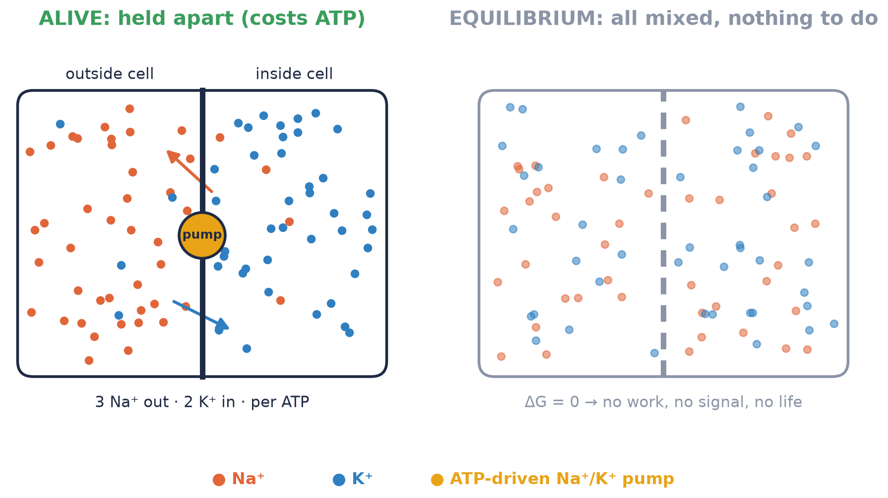
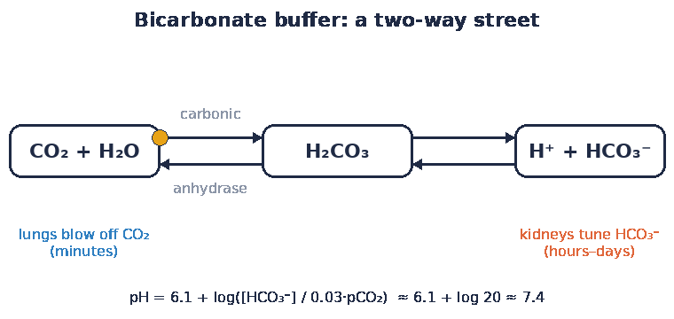
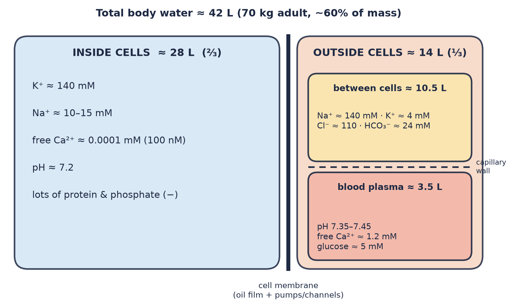
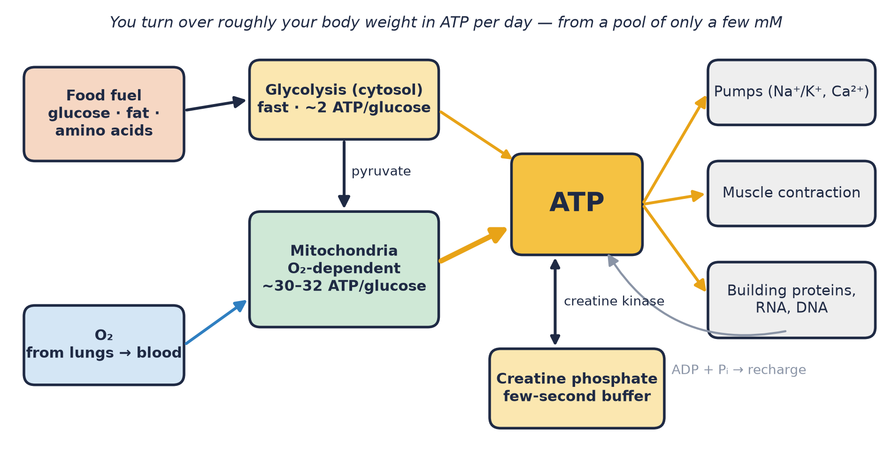
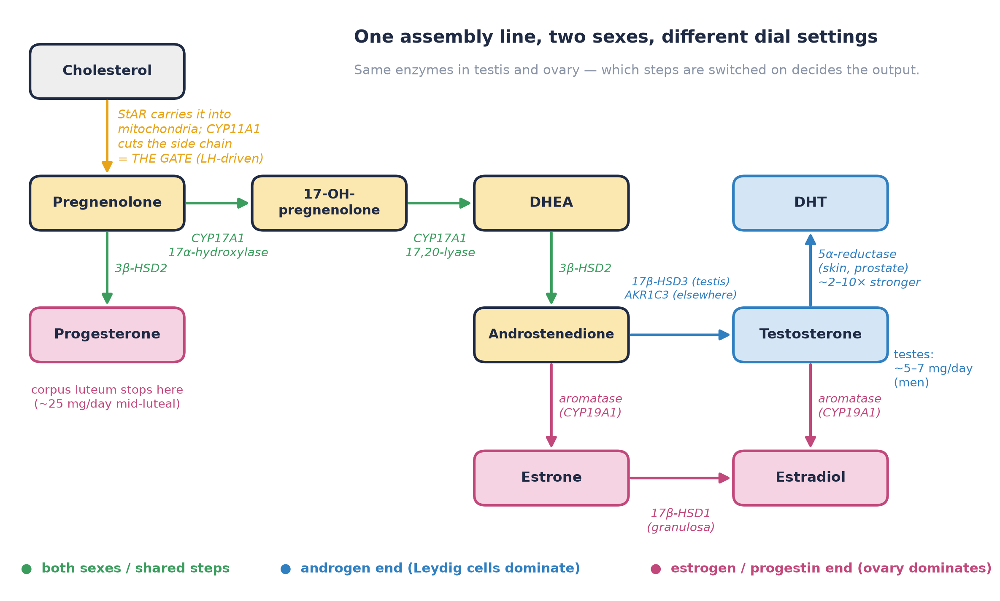

# The Chemistry That Refuses to Finish

*White paper 01 · Real-life human biology and chemistry (in vivo) · Draft 2 (map-first + sex-steroid chemistry)*

---
**Corpus Nova** · Theme 1 · Universal readers · PhD-worthy depth · Voice: alien-technology minimal · **License:** MIT · 2026-11-01

---
*Readers: anyone learning the real body, from curious beginners to working scientists. Terms are explained the first time they show up.*

---

## Abstract

A beaker of chemicals eventually settles down. The reactions run, the mixture evens out, and nothing else happens. Chemists call that **equilibrium** (the point where nothing changes on balance). Your body is a beaker that refuses to settle. It keeps sodium outside its cells and potassium inside. It keeps blood pH inside a band about 0.1 units wide. It keeps electrons moving downhill toward oxygen, every second, for decades. That costs energy, and the bill is paid in ATP. You recycle roughly your own body weight of ATP every day. This paper follows that idea through water, acids, electrons, energy, big molecules, signals, control loops, and sex-steroid chemistry. That last one is a single cholesterol-to-hormone assembly line that men and women share, with different dial settings. The short version: **being alive means staying away from equilibrium on purpose.** The textbook reactions are real. In a living body they just run inside small rooms, at limited speeds, with plenty of local noise.

---

## 1. The factory that never finishes

Picture a factory with every door open, every conveyor belt running, and a staff that rebuilds the machines while the shift is on. Raw materials come in (food and oxygen). Products and waste go out (CO₂, water, urea, heat). Nothing inside sits still for long.

That's the body seen as chemistry. The key idea fits in one line:

> **Equilibrium is what happens after you die.**

At equilibrium a reaction's free-energy change (**ΔG**, the energy available to do work) is zero. Nothing pushes in either direction, so you can't get work out of it. Living cells keep their important reactions *far* from that point. They hold up gradients (differences in concentration, charge, or pressure between two places) the way a dam holds water. Then they let a little flow through, on purpose, to do jobs: firing a nerve, contracting a muscle, building a protein.

Erwin Schrödinger made this point in 1944. Life, he said, feeds on "negative entropy": it keeps its internal order by exporting disorder, mostly as heat and small waste molecules (Schrödinger 1944). Eighty years later, the details are clearer and the slogan still holds.

*Figure 1. Left: a living membrane. A pump spends one ATP to move 3 Na⁺ out and 2 K⁺ in, which keeps the two sides different. Right: the same box at equilibrium. Everything is mixed and nothing is left to drive work.*

---

## 2. Core chemistry, as it really runs

### 2.1 Water: the solvent that also joins in

Water is about 60% of an adult man's body mass, a little less on average for women. For a 70 kg adult that's roughly **42 liters**. About two thirds sits inside cells and one third outside (Boron & Boulpaep 2017). Water does more than dissolve things. It's a **reactant** (an ingredient that gets used up) in every hydrolysis, the "split with water" reaction that breaks down ATP, proteins, and fats. It's also a **product**: burning fuel in your mitochondria makes a few hundred milliliters of "metabolic water" a day.

Water also has to cross membranes quickly. Special channel proteins called **aquaporins** let it through in single file, billions of molecules per second per channel (Preston et al. 1992). Without them, kidneys couldn't concentrate urine.

### 2.2 pH: a shock absorber you can breathe

**pH** measures acidity. Lower numbers mean more free H⁺ ions. Arterial blood stays between about **7.35 and 7.45**. Since the scale is logarithmic, that whole band is only about a 25% swing in H⁺. Proteins notice even that much. Their charges shift, their shapes shift, and hemoglobin's grip on oxygen changes.

The main shock absorber is the **bicarbonate buffer**. A buffer is a chemical pair that soaks up added acid or base so the pH barely moves.

CO₂ + H₂O ⇌ H₂CO₃ ⇌ H⁺ + HCO₃⁻

The first step is sped up enormously by the enzyme **carbonic anhydrase**, one of the fastest enzymes known. What makes this buffer special is that it's *open*. Both ends are under active control:

- **Lungs** set CO₂. Breathe faster and you blow off acid within minutes.
- **Kidneys** set bicarbonate (HCO₃⁻). That adjustment takes hours to days.

Plug in normal numbers (HCO₃⁻ ≈ 24 mM; CO₂ pressure ≈ 40 mmHg, which is ≈ 1.2 mM dissolved CO₂) and the Henderson–Hasselbalch equation gives:

pH = 6.1 + log(24 / 1.2) = 6.1 + log 20 ≈ **7.4**

On paper, a buffer with a pKa of 6.1 (the pH where it buffers best) is a poor match for pH 7.4. In the body it works far better than that, because lungs and kidneys keep resetting both ends of the reaction (Boron & Boulpaep 2017). Inside cells, pH sits a little lower, around 7.2. Separate pumps and exchangers hold it there, and each organelle sets its own value (Casey et al. 2010).

*Figure 2 (GIF). The bicarbonate system runs both ways. Lungs adjust the left end in minutes; kidneys adjust the right end over hours to days.*

### 2.3 Electrolytes: charge kept apart on purpose

**Electrolytes** are dissolved ions, the charged atoms and small molecules in your fluids. The striking thing is how unevenly they're spread:

| Ion | Inside cells | Outside cells |
|---|---|---|
| K⁺ | ~140 mM | ~4 mM |
| Na⁺ | ~10–15 mM | ~140 mM |
| free Ca²⁺ | ~0.0001 mM (100 nM) | ~1.2 mM |

Calcium shows the biggest split, about **10,000-fold**. That's why a small puff of Ca²⁺ into the cytosol works as such a loud signal (Clapham 2007). The Na⁺/K⁺ pump (the **Na⁺/K⁺-ATPase**, discovered by Skou in 1957) keeps the sodium and potassium gradients in place. Each cycle moves 3 Na⁺ out and 2 K⁺ in for one ATP. Because more positive charge leaves than enters, the pump also helps make the inside of the cell negative, about −70 mV in a typical neuron and closer to −90 mV in muscle.

This upkeep is expensive. Of the oxygen your body uses to make ATP at rest, roughly **19–28% powers the Na⁺/K⁺ pump** and about 25–30% powers protein synthesis (Rolfe & Brown 1997). A good share of your resting metabolism goes into keeping the dam full.

*Figure 3. Where the body's water sits, with typical ion levels. The thick line is the cell membrane, an oily film studded with pumps and channels. The dashed line is the capillary wall, which lets small ions through but holds back most proteins.*

### 2.4 Redox: electrons on a conveyor belt

**Redox** (reduction–oxidation) chemistry is about moving electrons. Eating, at the chemical level, means taking electrons out of food and passing them, step by step, to oxygen.

The main electron carrier is **NAD⁺**, which picks up electrons and becomes **NADH**. The ratio of the two works like a pressure gauge for electrons, and it differs from room to room. In classic rat-liver measurements, the free NAD⁺/NADH ratio was about **700 in the cytosol** (the cell's main fluid) but only about **7–8 inside mitochondria** (Williamson, Lund & Krebs 1967). Same molecule, two very different settings, separated by one membrane.

**Glutathione** (GSH) is a small sulfur-containing peptide present at about 1–10 mM in cells. It acts as the cell's redox buffer. In the cytosol it's kept mostly in the reduced form, usually well over 100 reduced molecules for each oxidized one (Schafer & Buettner 2001). The point isn't to be "anti-oxidant" all the time. The point is to stay *controlled*.

### 2.5 Oxygen: useful, and handled carefully

Oxygen is the final electron catcher in your mitochondria. Without it, the conveyor belt stops. Hemoglobin brings it in: arterial blood is about 97–98% saturated with O₂, and venous blood at rest still runs about 75%, so there's reserve built in.

Some electrons leak off early and form **reactive oxygen species** (ROS), such as superoxide and hydrogen peroxide. Popular articles tend to treat ROS as pure villains. In fact, low, local levels of H₂O₂ act as normal signals. They switch specific proteins on and off by oxidizing particular cysteines (Sies & Jones 2020). Trouble starts when production outruns cleanup, and where ROS come from matters as much as how much there is (Murphy 2009). The real goal is regulated oxidation, not zero oxidation.

---

## 3. Energy currency: ATP, the coin you can't save

### 3.1 The coin

**ATP** (adenosine triphosphate) is the cell's spending money. Breaking off its last phosphate releases energy that pumps, motors, and building enzymes can use. Under textbook "standard" conditions, that step releases about −30.5 kJ/mol. Inside a real cell, ATP is kept far more concentrated than ADP and phosphate, so each split delivers more, about **−50 to −60 kJ/mol**. The coin is worth more because the cell keeps its wallet unbalanced. That's the equilibrium theme again.

The ATP on hand is small, only a few millimolar in most cells. Yet a resting person turns over **roughly their body weight in ATP every day** (Törnroth-Horsefield & Neutze 2008). Each ATP molecule gets recharged hundreds to thousands of times a day. ATP works like a fast-moving currency, not a savings account.

### 3.2 The petty-cash drawer: creatine phosphate

Muscle and brain keep a quick backup called **creatine phosphate** (PCr), at roughly 20–30 mM in skeletal muscle. The enzyme **creatine kinase** moves a phosphate from PCr to ADP almost instantly, so ATP stays steady while demand spikes. In an all-out sprint, PCr carries much of the load for the first several seconds. Creatine kinase forms also sit next to mitochondria and next to the muscle fibers, which makes PCr a delivery network as well as a reserve (Wallimann et al. 1992).

### 3.3 Two ways to make ATP: fast lane and long haul

*Figure 4. Fuel and oxygen go in, ATP comes out, and ATP is spent on pumps, motors, and building. Glycolysis is fast but yields little. Mitochondria are slower but yield a lot. Creatine phosphate covers sudden spikes.*

- **Glycolysis** (sugar splitting) happens in the cytosol and doesn't need oxygen. One glucose gives **2 ATP**, plus two pyruvates. It's fast and close to where the energy is needed.
- **Oxidative phosphorylation** happens in mitochondria and needs oxygen. Electrons from NADH flow down a chain of proteins that pump protons out, which charges the inner membrane to about 150–180 mV. Protons then flow back through **ATP synthase**, a rotary motor, and drive it to make ATP. Peter Mitchell's **chemiosmotic** idea (that a proton gradient couples burning fuel to making ATP) won him a Nobel Prize (Mitchell 1961). Fully burning one glucose this way gives about **30–32 ATP**. Older textbooks say 36–38, but those numbers came from whole-number guesses that measurements later revised (Hinkle 2005).

So glycolysis is the fast lane, with low yield per glucose but quick to ramp up. Mitochondria are the long haul, with about 15 times the yield per glucose but dependent on oxygen supply. Lactate, the product of fast glycolysis, isn't just waste. It travels through the blood and gets burned as fuel by the heart, muscle, and other tissues (Brooks 2018; Hui et al. 2017).

---

## 4. Big molecules at work

### 4.1 Proteins as machines

Proteins are folded chains of amino acids. They act as tools, motors, gates, and sensors. As enzymes (catalysts that speed reactions without being used up), most are only moderately fast. The median enzyme turns over about **10 molecules per second**, not the millions per second of star performers like carbonic anhydrase (Bar-Even et al. 2011). That shapes how the body works. Cells often reach the speed they need by making **more copies** of an enzyme and **putting them in the right place**, since each copy has a limited top speed.

### 4.2 Membranes as selective oil films

A cell membrane is a lipid bilayer: two layers of oily molecules about 4–5 nm thick. Oil keeps ions out very effectively, which is exactly why gradients can exist at all. Proteins embedded in the film decide what crosses:
- **channels** are gated holes that open and close,
- **transporters** are revolving doors, and some swap one molecule for another,
- **pumps** are doors that charge a fee in ATP.

The physics of how membranes bend and stretch belongs to the Cell Physics paper. Here the membrane matters as the wall that lets the body keep its chemistry unbalanced.

### 4.3 DNA and RNA: working copies

It's easy to think of DNA as a locked archive. In living tissue it's busier than that. It's read constantly, marked with chemical tags, and repaired around the clock. **RNA** copies are the working printouts, and they don't last long. In one large study of mammalian cells, the typical mRNA lasted about **9 hours** and the typical protein about **46 hours** (Schwanhäusser et al. 2011). So the "parts list" of a cell is partly rebuilt every couple of days, paid for in ATP and GTP, which is the protein-synthesis share in Section 2.3.

---

## 5. Signaling chemistry (brief)

Cells talk with molecules:
- **Hormones** travel through the blood. Insulin, cortisol, and thyroid hormone are examples, with effects over minutes to days.
- **Neurotransmitters** cross a gap of about 20 nm in under a millisecond. Glutamate, GABA, and acetylcholine are examples.
- **Second messengers** pass the message along inside the cell. **cAMP**, Ca²⁺, and lipid fragments relay and amplify a signal that arrived at the surface (Sutherland 1972; Clapham 2007).

From a chemist's point of view, every one of these is a concentration change pushed against a background that's held steady. A Ca²⁺ signal only works because cytosolic Ca²⁺ is normally kept 10,000 times lower than outside. *Which* receptor hears *which* molecule is a whole story of its own, told in the **Receptors** paper (Theme 3).

---

## 6. Homeostasis as chemical control loops

**Homeostasis** means "staying the same," but it's active, like a thermostat that never switches off. Two loops are worth knowing well.

**Glucose.** A 70 kg adult has only about **4 grams** of glucose in the blood at any moment, about a teaspoon, at roughly 4–6 mM when fasting (Wasserman 2009). The brain alone burns around 100–120 g a day, so that teaspoon has to be refilled again and again. After a meal, **insulin** from the pancreas tells muscle and fat to take glucose up and tells the liver to stop releasing it. Between meals, **glucagon** tells the liver to release glucose from its glycogen stores and to make new glucose. The control is spread across several organs. Delivery by blood flow, transport into cells, and the first chemical step inside the cell all share the job (Wasserman 2009).

**CO₂ and pH.** Sensors in the brainstem and in the carotid arteries detect CO₂ and pH and adjust breathing within seconds to minutes (Guyenet & Bayliss 2015). Breathing ends up mostly controlled by CO₂, with oxygen as a backup signal. That's the bicarbonate buffer from Section 2.2 run as a feedback loop, with the kidneys making slower corrections over days.

Both loops share a design. **Sensor → controller → effector → chemistry → sensor.** They're fast where it matters, slow where the stakes are lower, and spread over several organs.

---

## 7. Sex-steroid chemistry: one assembly line, two dial settings

Section 6 described control loops in general. Sex hormones are one of the best examples, and the chemistry is easy to tell once you see the trick: **men and women build their sex hormones on the same assembly line.** The enzymes are the same. The tissues just switch different steps up or down. Everyone makes testosterone, estradiol, and progesterone. What differs is how much, where, and on what schedule.

A **steroid** is a molecule built from four fused rings of carbon atoms. Every steroid hormone in your body starts as **cholesterol**. Steroids are greasy, so they slip through cell membranes. Steroid-making cells therefore can't stockpile their product in little packets the way a pancreas stores insulin. They make it **on demand**, and the speed of the first step sets the output (Miller & Auchus 2011).

*Figure 5. One pathway in both sexes. Cholesterol passes through a single gate (StAR + CYP11A1) to become pregnenolone, then branches. The testis pushes flow toward testosterone. The ovary pushes it on through aromatase to estradiol, and after ovulation it mostly stops at progesterone. Production numbers are typical adult values (Handelsman 2026; Reed & Carr 2018).*

### 7.1 The gate: cholesterol → pregnenolone

Two proteins work together at the first step, inside the **mitochondria** (the cell's power stations, Section 3):

- **StAR** (steroidogenic acute regulatory protein) is the ferry. It moves cholesterol from the outer mitochondrial membrane to the inner one, where the enzyme waits. Cholesterol is insoluble in water, so this crossing is the true bottleneck.
- **CYP11A1** (also called P450scc, "side-chain cleavage") is the cutter. It snips the six-carbon tail off cholesterol in three oxygen-and-electron-using steps and leaves **pregnenolone**, the parent of all steroid hormones. ("CYP" marks a **cytochrome P450**, an iron-containing enzyme family that uses O₂ to reshape molecules.)

Miller & Auchus (2011) call this "the first and rate-limiting step in steroidogenesis." The fast control (minutes) mostly comes from making more StAR. The slow control (hours to days) comes from making more of the enzymes. In plain words: **a hormone signal opens the gate, and the gate decides the flow.** Burger (2002) puts it the same way for women: StAR together with the side-chain-cleavage enzyme "is rate limiting for all steroid synthesis."

### 7.2 After the gate: the branch points

- **CYP17A1** does two jobs in a row. First it adds an –OH group (17α-hydroxylase). Then it cuts off two more carbons (17,20-lyase), turning a 21-carbon steroid into a 19-carbon one. Human cells mostly take the route pregnenolone → 17-OH-pregnenolone → **DHEA**. The second job needs a helper protein (cytochrome b5), which acts like a volume knob for androgen output (Miller & Auchus 2011).
- **3β-HSD2** rearranges the rings. It turns pregnenolone into **progesterone** and DHEA into **androstenedione**.
- **17β-HSD3** (mainly in the testis) or **AKR1C3** (elsewhere) adds two hydrogens to make **testosterone**.
- **Aromatase (CYP19A1)** removes one more carbon and makes the first ring "aromatic" (flat and very stable). That turns androgens into **estrogens**: androstenedione → estrone and testosterone → estradiol (Simpson et al. 2002).
- **5α-reductase** turns testosterone into **DHT** (dihydrotestosterone), a stronger androgen that can't be turned into estrogen (Section 7.7).

### 7.3 Male production: Leydig cells and the LH drive

About 95% of a man's testosterone comes from **Leydig cells**, small cells packed between the sperm-making tubules of the testis. The command chain goes like this. The hypothalamus pulses out GnRH. The pituitary answers with **LH** (luteinizing hormone). LH binds its receptor on Leydig cells, the second messenger **cAMP** rises (Section 5), and the cell makes more StAR within minutes and more steroid enzymes over hours (Zirkin & Papadopoulos 2018). Receptor details belong to the **Receptors** paper (Theme 3).

The numbers:
- **Output:** about 5–7 mg of testosterone per day. Isotope-tracer estimates range from about 3 to 10 mg/day. Roughly 4% becomes DHT and about 0.2% becomes estradiol (Handelsman 2026).
- **A steep local gradient.** Testosterone inside the testis runs about **40–100×** higher than in blood (Coviello et al. 2004; Jarow & Zirkin 2005). Sperm production needs that local flood, which is why testosterone taken as a drug, by switching off LH, can *lower* sperm counts. It's Section 1's idea again: a gradient held up on purpose.
- **Circulating range:** in healthy, non-obese men aged 19–39, the harmonized range is **264–916 ng/dL** (about 9.2–31.8 nmol/L), with a median near 530 ng/dL (Travison et al. 2017). A mass-spectrometry range from another review is 7.7–29.4 nmol/L (Handelsman et al. 2018).
- **Daily rhythm:** in men aged 30–40, levels at 4 p.m. are **20–25% lower** than at 8 a.m. The swing shrinks to about 10% by age 70, which is why testosterone tests are done in the morning (Brambilla et al. 2009).
- **Feedback:** testosterone, and the estradiol made from it, signal back to the brain and pituitary to slow GnRH and LH. That makes a steady **negative-feedback** loop with a daily ripple.

### 7.4 Female production: the two-cell ovary

The ovary splits the job between two neighboring cell types around each developing egg. This is the classic **two-cell, two-gonadotropin model** (Hillier et al. 1994):

1. **Theca cells** (outer layer) respond to LH and make androgens, mainly androstenedione, using the same StAR → CYP11A1 → CYP17A1 route as Leydig cells.
2. That androstenedione drifts inward to the **granulosa cells**, which respond to **FSH** (follicle-stimulating hormone). FSH turns on aromatase, which converts androgen to estrone, and 17β-HSD1 then makes **estradiol** (Reed & Carr 2018).

So **ovarian estrogen literally starts as androgen.** After ovulation, the emptied follicle reorganizes into the **corpus luteum** ("yellow body"). Its job is mostly to stop at the progesterone branch and pour progesterone out.

Daily ovarian output across the cycle (Baird & Fraser 1974, tabulated in Reed & Carr 2018):

| Hormone | Early follicular | Pre-ovulation | Mid-luteal |
|---|---|---|---|
| Estradiol | ~36 µg/day | ~380 µg/day | ~250 µg/day |
| Progesterone | ~1 mg/day | ~4 mg/day | ~25 mg/day |

Typical blood levels, which vary a lot between labs and assays:
- **Estradiol** runs from roughly tens of pg/mL early in the cycle to a pre-ovulatory peak of a few hundred pg/mL.
- **Progesterone** sits below about 1 ng/mL before ovulation and around 10–20 ng/mL at mid-luteal (Stricker et al. 2006; Reed & Carr 2018).

Women make testosterone too, at about 0.1–0.4 mg/day. Roughly a quarter comes from the ovary, a quarter from the adrenal glands, and half from conversion of androstenedione in other tissues (Burger 2002). Other estimates put it closer to equal thirds (Handelsman et al. 2018), and the split depends on how it is measured. Blood levels are about **20–70 ng/dL** (0.6–2.5 nmol/L) (Burger 2002), or 0–1.7 nmol/L by mass spectrometry (Handelsman et al. 2018). That's roughly **10–15× below** typical male levels. By mass, women actually secrete more androgen than estrogen (Burger 2002).

### 7.5 The cycle as a chemical control loop that flips sign

For most of the cycle, estradiol and progesterone do what testosterone does in men: they **damp down** GnRH, LH, and FSH. That's negative feedback.

Then something rare in physiology happens. When estradiol stays above about **200 pg/mL for roughly 50 hours**, the pituitary switches to **positive feedback**: high estradiol now calls for *more* LH. The result is the **LH surge**, and ovulation follows about **34–36 hours** after the surge begins (Reed & Carr 2018). Afterward the corpus luteum makes progesterone for about 14 days. If no pregnancy hormone (hCG) arrives to rescue it, the corpus luteum shuts down. Progesterone and estradiol fall, FSH rises again, and a new cycle starts.

For an engineer, the male loop is a thermostat with a daily ripple. The female loop is a thermostat that is built to overshoot once a month on purpose, which is how it releases an egg on schedule.

### 7.6 Riding in the blood: free vs bound

Steroids are greasy, so most travel on carrier proteins (Section 2's "the blood value isn't the whole story" again):
- **SHBG** (sex hormone-binding globulin, made by the liver) grips testosterone tightly and holds about **44%** of it.
- **Albumin** holds about **50%**, but loosely, so that share can come off in tissue capillaries. Free plus albumin-bound testosterone is called "bioavailable."
- Only about **1–3%** is truly **free** (Dunn et al. 1981; Goldman et al. 2017). Estradiol rides mostly on albumin (~78%), with ~20% on SHBG and ~2% free.

SHBG goes up with estrogen and thyroid hormone. It goes down with obesity, insulin resistance, and inflammation. So two people can share a total testosterone number while having quite different free levels (Goldman et al. 2017).

### 7.7 Conversion in the periphery: aromatase and 5α-reductase

Tissues don't just receive hormones. They **remake** them.
- **Aromatase** works in fat, bone, brain, and skin as well as the gonads (Simpson et al. 2002). In men, about **80%** of circulating estradiol is made outside the testis, mainly in fat (Handelsman 2026). That estradiol matters: in a controlled trial, estradiol (not testosterone) mainly kept body fat in check in men (Finkelstein et al. 2013). After menopause, the ovary stops making estradiol, and estrone made by aromatase in fat becomes the main estrogen. Fat-tissue chemistry is covered in the **Adipose** paper (Theme 5). Bone effects are in **Bone Metrics** (Theme 4).
- **5α-reductase** turns testosterone into **DHT**. Type 2 dominates in the prostate and genital skin. Type 1 dominates in adult skin and liver (Thigpen et al. 1993). DHT binds the androgen receptor about 2–5× more tightly than testosterone and is about 10× more potent in signaling (Azzouni et al. 2012). It's a local amplifier, and because DHT can't be aromatized, it's a "pure" androgen.

**Takeaway:** sex-steroid chemistry is one shared pathway with tissue-specific dial settings, gated at one mitochondrial step, carried mostly on proteins, and rebuilt locally. Anatomy of the organs is in **Whole Body** (Theme 6). The receptors that read these molecules are in **Receptors** (Theme 3).

---

## 8. What real life changes compared with the textbook

Textbook reactions are accurate, but they describe a single well-stirred beaker. Real tissue differs in five ways:

1. **Compartments.** The cell is a set of rooms. The same NAD⁺/NADH pair can sit at a ratio of ~700 in one room and ~7 in the next. Average concentrations can hide the values that actually matter.
2. **Gradients.** Oxygen drops from about 100 mmHg in arterial blood to just a few mmHg near mitochondria. Cells near a capillary and cells 100 µm away live in different chemical conditions.
3. **Rates over balance.** Most of the interesting chemistry is about *flux* (how fast material flows through a pathway), not about final balance points. A pathway's direction depends on how fast products are removed downstream.
4. **Noise.** Many molecules exist at low copy numbers. Two genetically identical cells side by side can make different amounts of the same protein just by chance (Elowitz et al. 2002). The body works with that variation and sometimes depends on it.
5. **Local microenvironments.** A working muscle fiber gets acidic, a tumor core runs short of oxygen, and a bone-resorbing cell acidifies the small patch underneath it. Local pH, oxygen, and ion levels can be far from the blood values on a lab report.

If you remember one thing from this section: **a blood test reports the average, but cells live in their own local conditions.**

---

## 9. Why this lens matters for the rest of the project

This paper is the chemistry foundation for the others. Each sibling paper looks at a different layer:

- **Cell Physics** (Theme 2): how crowding, diffusion, and force shape the reactions described here.
- **Receptors** (Theme 3): which molecular "locks" read the signals from Section 5, including the androgen, estrogen, and progesterone receptors that read Section 7.
- **Bone Metrics** (Theme 4): bone is a mineral store tied directly to the calcium and phosphate balance covered here, and estradiol protects it in both sexes.
- **Adipose** (Theme 5): how the body stores fuel for the ATP economy, and how fat aromatase makes estrogen (Section 7.7).
- **Whole Body** (Theme 6): the anatomy that holds all these compartments, including the testes, ovaries, and reproductive tracts.

### 9.1 Map-first: this paper is a payload source

The project's interactive body map is the main product, and this paper supplies its **chemistry content**. Every section above is broken into short, cited hover cards:

| Map surface | Payload file(s) | Comes from |
|---|---|---|
| Blood / vessels | `body-map/regions/blood-vessels-chemistry.md` | §2.2 pH, §2.3 electrolytes, §2.5 O₂, §7.6 carriers |
| Heart (and working muscle) | `body-map/regions/heart-metabolic-chemistry.md` | §3 ATP, creatine phosphate, lactate |
| Testis | `body-map/regions/gonads-male-chemistry.md` | §7.1–7.3, §7.7 |
| Ovary | `body-map/regions/gonads-female-chemistry.md` | §7.1–7.2, §7.4–7.5 |
| Library cards | `library/biology-chemistry/`, `library/hormones/`, `library/male-reproductive/`, `library/female-reproductive/` | all sections |

Male and female layers are written in parallel, with the same depth and the same card fields, so the map can toggle between them without one looking like an afterthought.

**We don't build an anatomy viewer.** Good open-source 3D and 2D body viewers already exist. They're surveyed in `notes/github-anatomy-landscape.md`, and candidates include ashemag/human-atlas, slorksmo/Human-Atlas (with male and female models), Z-Anatomy, and open-anatomy-studio, plus datasets such as BodyParts3D. The map UI should reuse one of those (license permitting). This paper's job is the **payloads**: accurate, cited chemistry that gets attached to the regions those viewers already draw.

One last image to keep: you aren't a finished mixture. You're a chemical gradient that's still running, kept going by roughly 70 kg of ATP turnover a day, and steered in part by a handful of milligrams of steroid hormone made fresh each day from cholesterol.

---

## Sources / further reading

Full citations with DOIs are in [`../sources/biology-chemistry-paper1-sources.md`](../sources/biology-chemistry-paper1-sources.md).

**Classics**
- Schrödinger E. (1944). *What Is Life?* Cambridge University Press.
- Mitchell P. (1961). Coupling of phosphorylation to electron and hydrogen transfer by a chemi-osmotic type of mechanism. *Nature* 191:144–148.
- Skou J.C. (1957). The influence of some cations on an adenosine triphosphatase from peripheral nerves. *Biochim Biophys Acta* 23:394–401.
- Williamson D.H., Lund P., Krebs H.A. (1967). The redox state of free nicotinamide-adenine dinucleotide in the cytoplasm and mitochondria of rat liver. *Biochem J* 103:514–527.
- Sutherland E.W. (1972). Studies on the mechanism of hormone action. *Science* 177:401–408.
- Preston G.M., Carroll T.P., Guggino W.B., Agre P. (1992). Appearance of water channels in *Xenopus* oocytes expressing red cell CHIP28 protein. *Science* 256:385–387.

**Energy, redox, oxygen**
- Wallimann T. et al. (1992). The "phosphocreatine circuit" for cellular energy homeostasis. *Biochem J* 281:21–40.
- Rolfe D.F.S., Brown G.C. (1997). Cellular energy utilization and molecular origin of standard metabolic rate in mammals. *Physiol Rev* 77:731–758.
- Schafer F.Q., Buettner G.R. (2001). Redox environment of the cell as viewed through the redox state of the glutathione disulfide/glutathione couple. *Free Radic Biol Med* 30:1191–1212.
- Hinkle P.C. (2005). P/O ratios of mitochondrial oxidative phosphorylation. *Biochim Biophys Acta* 1706:1–11.
- Törnroth-Horsefield S., Neutze R. (2008). Opening and closing the metabolite gate. *PNAS* 105:19565–19566.
- Murphy M.P. (2009). How mitochondria produce reactive oxygen species. *Biochem J* 417:1–13.
- Hui S. et al. (2017). Glucose feeds the TCA cycle via circulating lactate. *Nature* 551:115–118.
- Brooks G.A. (2018). The science and translation of lactate shuttle theory. *Cell Metab* 27:757–785.
- Sies H., Jones D.P. (2020). Reactive oxygen species (ROS) as pleiotropic physiological signalling agents. *Nat Rev Mol Cell Biol* 21:363–383.

**pH, signaling, control, real-life variability**
- Elowitz M.B., Levine A.J., Siggia E.D., Swain P.S. (2002). Stochastic gene expression in a single cell. *Science* 297:1183–1186.
- Clapham D.E. (2007). Calcium signaling. *Cell* 131:1047–1058.
- Wasserman D.H. (2009). Four grams of glucose. *Am J Physiol Endocrinol Metab* 296:E11–E21.
- Casey J.R., Grinstein S., Orlowski J. (2010). Sensors and regulators of intracellular pH. *Nat Rev Mol Cell Biol* 11:50–61.
- Bar-Even A. et al. (2011). The moderately efficient enzyme. *Biochemistry* 50:4402–4410.
- Schwanhäusser B. et al. (2011). Global quantification of mammalian gene expression control. *Nature* 473:337–342.
- Guyenet P.G., Bayliss D.A. (2015). Neural control of breathing and CO₂ homeostasis. *Neuron* 87:946–961.

**Sex-steroid chemistry**
- Baird D.T., Fraser I.S. (1974). Blood production and ovarian secretion rates of estradiol-17β and estrone in women throughout the menstrual cycle. *J Clin Endocrinol Metab* 38:1009–1017.
- Dunn J.F., Nisula B.C., Rodbard D. (1981). Transport of steroid hormones: binding of 21 endogenous steroids to both testosterone-binding globulin and corticosteroid-binding globulin in human plasma. *J Clin Endocrinol Metab* 53:58–68.
- Thigpen A.E. et al. (1993). Tissue distribution and ontogeny of steroid 5α-reductase isozyme expression. *J Clin Invest* 92:903–910.
- Hillier S.G., Whitelaw P.F., Smyth C.D. (1994). Follicular oestrogen synthesis: the "two-cell, two-gonadotrophin" model revisited. *Mol Cell Endocrinol* 100:51–54.
- Burger H.G. (2002). Androgen production in women. *Fertil Steril* 77 Suppl 4:S3–S5.
- Simpson E.R. et al. (2002). Aromatase—a brief overview. *Annu Rev Physiol* 64:93–127.
- Coviello A.D. et al. (2004). Intratesticular testosterone concentrations comparable with serum levels are not sufficient to maintain normal sperm production in men receiving a hormonal contraceptive regimen. *J Androl* 25:931–938.
- Jarow J.P., Zirkin B.R. (2005). The androgen microenvironment of the human testis and hormonal control of spermatogenesis. *Ann N Y Acad Sci* 1061:208–220.
- Stricker R. et al. (2006). Establishment of detailed reference values for LH, FSH, estradiol, and progesterone during different phases of the menstrual cycle on the Abbott ARCHITECT analyzer. *Clin Chem Lab Med* 44:883–887.
- Brambilla D.J. et al. (2009). The effect of diurnal variation on clinical measurement of serum testosterone and other sex hormone levels in men. *J Clin Endocrinol Metab* 94:907–913.
- Miller W.L., Auchus R.J. (2011). The molecular biology, biochemistry, and physiology of human steroidogenesis and its disorders. *Endocr Rev* 32:81–151.
- Azzouni F. et al. (2012). The 5 alpha-reductase isozyme family: a review of basic biology and their role in human diseases. *Adv Urol* 2012:530121.
- Finkelstein J.S. et al. (2013). Gonadal steroids and body composition, strength, and sexual function in men. *N Engl J Med* 369:1011–1022.
- Goldman A.L. et al. (2017). A reappraisal of testosterone's binding in circulation: physiological and clinical implications. *Endocr Rev* 38:302–324.
- Travison T.G. et al. (2017). Harmonized reference ranges for circulating testosterone levels in men of four cohort studies in the United States and Europe. *J Clin Endocrinol Metab* 102:1161–1173.
- Handelsman D.J., Hirschberg A.L., Bermon S. (2018). Circulating testosterone as the hormonal basis of sex differences in athletic performance. *Endocr Rev* 39:803–829.
- Reed B.G., Carr B.R. (2018). The normal menstrual cycle and the control of ovulation. In: *Endotext* (MDText.com), updated 5 Aug 2018.
- Zirkin B.R., Papadopoulos V. (2018). Leydig cells: formation, function, and regulation. *Biol Reprod* 99:101–111.
- Handelsman D.J. (2026). Androgen physiology, pharmacology, use and misuse. In: *Endotext* (MDText.com), updated 26 Oct 2026.

**Textbooks & number books**
- Boron W.F., Boulpaep E.L. (2017). *Medical Physiology*, 3rd ed. Elsevier.
- Milo R., Phillips R. (2015). *Cell Biology by the Numbers*. Garland Science. (Free online: book.bionumbers.org)
- Alberts B. et al. (2022). *Molecular Biology of the Cell*, 7th ed. W.W. Norton.

---
**License:** MIT — © 2026 Corpus Nova contributors. See `/LICENSE`. Third-party atlas meshes retain their own licenses.
