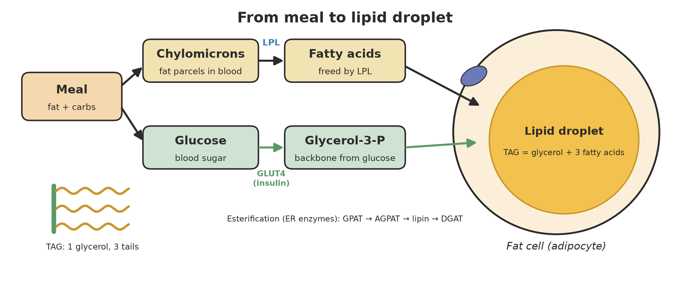
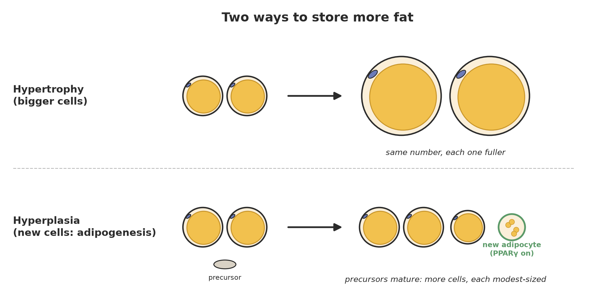
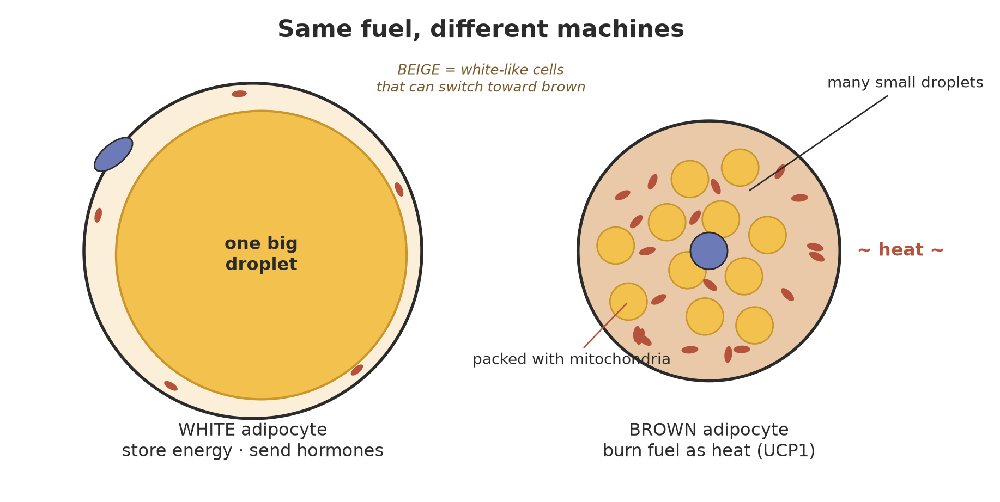

# How Fat Is Built
### From meal to lipid droplet

*Theme 5 · Adipose tissue · Paper 01 · Map-first content source*
*Audience: universal · Depth: PhD-worthy · Voice: abstract, easy, fun, simple*

**Feeds:** `body-map/overlays/adipose-depots.json` · `body-map/adipose-regions.md` · `library/adipose-metabolism/`  
**Does not build:** 3D viewers (reuse open atlases — `notes/github-anatomy-landscape.md`).

> Energy that doesn't leave the body has to live somewhere. Fat is where it lives: a dense, tidy, reversible archive. This paper follows one lunch from your plate into a fat cell, then asks how the body decides to make *new* fat cells or just fill the old ones, and why some fat stores fuel while other fat burns it as heat.

---

## 1. The big idea: fat is a storage format

Think of fat less as "extra stuff" and more as a **file format**. It's the way the body saves energy for later.

The format has a name: **triacylglycerol** (TAG, also called triglyceride). It's one small backbone, **glycerol**, with three long carbon chains called **fatty acids** clipped onto it. Picture a capital E: the spine is glycerol, the three arms are fatty acids.

Why this format and not another? Three reasons.

- **It's dense.** Fat holds about 9 kcal per gram (about 37 kJ). Carbohydrate and protein hold about 4.
- **It's dry.** TAG is oily, so it doesn't pull water along with it. **Glycogen**, the body's other fuel store (a branched chain of glucose sugar), travels with roughly two to three times its own weight in water. Gram for gram as actually stored, fat wins by a factor of about five or more.
- **It's reversible.** The same molecule that gets packed after a meal can be unpacked hours or months later.

A lean adult carries roughly 10–15 kg of fat. That's on the order of 100,000 kcal: weeks of fuel, folded into a few litres of tissue. Glycogen, by contrast, covers about a day.

So where does the body keep all those E-shaped molecules? Inside **lipid droplets**: oily blobs wrapped in a single layer of fat-and-protein "skin" (a phospholipid monolayer). Almost every cell can make a few. But one cell type has made it a career: the **adipocyte**, or fat cell. In a white adipocyte, a single droplet can fill more than 90% of the cell, squeezing the nucleus flat against the edge.

**Adipose tissue** is just the organized collection of those cells, plus blood vessels, nerves, immune cells, and a reserve of **precursor cells** (young cells that can become adipocytes later). Hold on to that last one. It matters in Section 3.

*How deep does the chemistry go? Not far here. Fatty-acid chemistry and membrane physics belong to the biology-chemistry and cell-physics papers. This one stays on the storage story.*

---

## 2. From meal to lipid droplet

### The abstract version

Building fat takes three steps:

1. **Get the parts.** Fatty acids and a glycerol backbone have to reach the fat cell.
2. **Assemble.** Enzymes clip three fatty acids onto the backbone. This step is called **esterification** (making the chemical bond, an *ester*, that joins them).
3. **Store.** The finished TAG gets pushed into a lipid droplet, which swells.

Now let's run it on a real meal.

### The concrete version: one cheese sandwich

**Step 1: the fat parcel.** You eat lunch. In the gut, dietary fat is broken down, absorbed by the intestinal lining, and rebuilt into TAG. That TAG is shipped out in big particles called **chylomicrons** (fat parcels wrapped in protein, made for travel in lymph and blood).

**Step 2: unloading at the curb.** Chylomicrons can't just walk into a fat cell. They're too big. Instead, the walls of the tiny blood vessels inside fat tissue carry an enzyme called **lipoprotein lipase** (LPL, a "fat-snipping" enzyme parked on the vessel lining). LPL cuts fatty acids off the passing TAG. The freed fatty acids then cross into the adipocyte, helped by transporters such as **CD36** (Goldberg, Eckel & Abumrad 2009). After a meal, insulin turns LPL up in fat tissue, so fat gets unloaded where it's meant to be stored.

**Step 3: the backbone.** The fatty acids need a spine to hang on. In fat cells that spine is mostly **glycerol-3-phosphate**, and it's made largely from glucose. That's one reason insulin matters so much here. Insulin moves the glucose transporter **GLUT4** to the cell surface, letting sugar in. Some of that sugar becomes backbone.

> **Fun fact.** Can the body turn sugar into new fatty acids from scratch? Yes. That's **de novo lipogenesis** ("making fat anew"). But in people on a typical mixed diet it's a fairly small stream. Most stored fat started as fat you ate (Hellerstein 1999). Sugar's bigger job in fat-building is supplying the backbone and the insulin signal.

**Step 4: the assembly line.** On the membrane network called the **endoplasmic reticulum** (ER, the cell's folded workshop for making lipids and proteins), four enzymes work in order (Coleman & Lee 2004):

- **GPAT** attaches fatty acid #1 to glycerol-3-phosphate.
- **AGPAT** attaches fatty acid #2.
- **Lipin** snips off the phosphate.
- **DGAT** attaches fatty acid #3. Now it's TAG.

**Step 5: the droplet.** Fresh TAG is oily, so it collects *between* the two layers of the ER membrane, like a bead of oil trapped inside a sandwich bag's seam. When the bead gets big enough, it buds off into the cytoplasm as a new lipid droplet (Walther & Farese 2012). Existing droplets can also grow in place: some TAG-making enzymes (GPAT4 and DGAT2) actually move from the ER onto droplet surfaces and build TAG right there (Wilfling et al. 2013). The warehouse is also the factory.

### The return trip

Storage only makes sense if you can withdraw. Between meals, during exercise, or under stress hormones, the cell runs the line in reverse. This is **lipolysis** (breaking fat apart). Three enzymes take turns, each removing one fatty acid: **ATGL**, then **HSL**, then **MGL** (Zimmermann et al. 2004; Zechner et al. 2012). Fatty acids and glycerol leave for the muscles, heart, and liver.

Keith Frayn called adipose tissue a **buffer** for daily lipid flux (Frayn 2002). It soaks up fat after meals and releases it between them, so other organs never get flooded or starved. A fat cell is less a vault and more a very busy bank.

---

## 3. New cells or bigger cells?

Say a body needs to store more fat for months. It has two options, and they look very different under the microscope.

- **Hypertrophy**: the cells you have get *bigger*. Same count, each droplet fuller.
- **Hyperplasia**: the body makes *more* cells. Precursors turn into new adipocytes, a process called **adipogenesis** ("fat-cell birth").

### How a fat cell is born

Adipogenesis is a switch, and the switch has a name: **PPARγ** (a "nuclear receptor," a protein that sits on DNA and flips genes on when it binds certain molecules). Turn on PPARγ in an ordinary connective-tissue cell (a fibroblast) and it starts making a fat cell (Tontonoz, Hu & Spiegelman 1994). Delete PPARγ and fat cells can't form at all (Rosen et al. 1999). It works with a family of partner proteins called **C/EBPs**. Together they hold each other on in a loop, so once the cell commits it *stays* a fat cell (Rosen & MacDougald 2006).

The newborn cell turns on the full toolkit: LPL, GLUT4, the TAG assembly line, droplet-coating proteins. Then it starts filling up.

### How many fat cells do you have?

Here's a surprise. In adults, the **number** of fat cells stays remarkably steady, whether a person is lean or has obesity, and even after big weight loss. Kirsty Spalding and colleagues measured cell ages using the carbon-14 that atmospheric nuclear tests left in the 1950s–60s, which works like a date stamp in DNA. They found that the number is mostly set by the end of adolescence. After that, about 10% of fat cells are replaced each year: old ones die, new ones are born, and the total stays put (Spalding et al. 2008).

So in day-to-day adult life, fat mass goes up and down mainly by **hypertrophy**. Cells swell and shrink.

But adult hyperplasia isn't off the table. Lineage-tracing mice, where new fat cells get a permanent color tag, show that a high-fat diet triggers new-cell production fast, and **depot by depot**. In male mice, belly fat around the reproductive organs recruits new adipocytes within weeks, while fat under the skin mostly swells existing cells (Wang et al. 2013; Jeffery et al. 2015).

### Why the choice matters

Many modest-sized cells are generally healthier than a few overstuffed ones. Very large adipocytes run short on oxygen, attract inflammatory immune cells, and leak fatty acids at the wrong times (Sun, Kusminski & Scherer 2011). When a depot can't safely expand, fat spills into places it doesn't belong, such as the liver and muscle.

The flip side is striking. Mice engineered to make extra **adiponectin**, a helpful hormone from fat cells, grow *more* fat under the skin, yet their metabolism stays much healthier (Kim et al. 2007). The lesson: **it's not just how much fat you store, but how well you store it.**

---

## 4. Three flavors of fat cell

Same fuel, different machines.

### White: the archive

**White adipocytes** are the classic fat cell: one giant droplet, a thin rim of everything else. Their job is storage. They're also hormone makers. White fat releases **leptin**, a "how full is the tank" signal to the brain (Zhang et al. 1994), and **adiponectin** (Scherer et al. 1995). Fat isn't just a warehouse. It talks.

### Brown: the furnace

**Brown adipocytes** look different. They hold many small droplets and are packed with **mitochondria** (the cell's power stations), which give the tissue its brownish color.

Normally, mitochondria burn fuel to pump protons (H⁺) across a membrane, then let those protons flow back through a turbine that makes ATP, the cell's energy currency. Brown fat cells carry a special protein, **UCP1** (uncoupling protein 1), that opens a side door. Protons rush back without turning the turbine, and the energy comes out as **heat** instead (Cannon & Nedergaard 2004). Patch-clamp recordings on brown-fat mitochondria show that UCP1 carries protons with help from fatty acids (Fedorenko, Lishko & Kirichok 2012). Neat detail: the fuel helps open the door that burns it.

Brown fat is a cold-defense organ. Babies have plenty. For decades adults were thought to lose it. Then in 2009, three papers in a single issue of *NEJM* used PET scans to show active brown fat in adults, mostly around the neck, collarbones, and spine, switching on in the cold (Cypess et al. 2009; van Marken Lichtenbelt et al. 2009; Virtanen et al. 2009).

Classic brown fat even has a surprising family tree. It shares a developmental lineage with **skeletal muscle**, and a protein called **PRDM16** flips precursor cells toward brown fat instead of muscle (Seale et al. 2008). Both tissues, after all, are in the business of making heat.

### Beige: the convertible

The third flavor lives *inside* white fat. **Beige** (or "brite") adipocytes sit quietly as white-looking cells until cold or certain hormones call them up. Then they grow mitochondria, turn on UCP1, and start making heat. They're a genuinely distinct cell type, not just brown cells that wandered off (Wu et al. 2012). And at least some of what was called "adult brown fat" in humans looks beige at the gene level.

| | White | Brown | Beige |
|---|---|---|---|
| Droplets | one large | many small | many small when active |
| Mitochondria | few | many | many when active |
| UCP1 | ~none | high | inducible |
| Job | store, signal | heat | heat on demand |

*How do receptors detect cold and noradrenaline to switch these cells on? That's receptor-theme territory. Here we just note the switch exists.*

---

## 5. Location, location, location

A **depot** is a neighborhood of fat. The two big neighborhoods are:

- **Subcutaneous fat**: under the skin (belly wall, hips, thighs, buttocks). It's the largest store in most people.
- **Visceral fat**: inside the belly cavity, wrapped around the gut (the omentum and mesentery). It's smaller in volume.

Same chemistry, different addresses. Address matters for three reasons.

1. **Drainage.** Visceral fat drains into the **portal vein**, which runs straight to the liver. Whatever visceral fat releases, the liver gets first.
2. **Cell-intrinsic personality.** Precursors from different depots keep different gene programs and behave differently even when grown side by side in a dish. They differ in how readily they make new cells, how fast they run lipolysis, and how much inflammatory signal they make (Tchkonia et al. 2013).
3. **Risk.** In the Framingham Heart Study, CT-measured visceral fat tracked with blood pressure, blood sugar, and blood lipid problems more strongly than subcutaneous fat did, even after accounting for overall size (Fox et al. 2007).

So two people with the same body weight can have very different fat stories. Hip-and-thigh (gluteofemoral) fat often behaves like a safe long-term deposit. Visceral fat behaves more like a busy, leaky account next door to the liver.

There are smaller specialist depots too: fat on the heart (epicardial), around the kidneys (perirenal), and inside bone marrow. Each deserves its own story. Body-map region notes live in `body-map/adipose-regions.md`.

---

## 5b. Sex biology: who builds fat where

Men and women are not just differently *sized* archives. They often file energy in different drawers. The map needs **male / female (or dual-layer)** fat views for this reason.

### Two classic patterns

- **Gynoid** (pear-leaning): more surplus in **hips, buttocks, and thighs** — gluteofemoral subcutaneous fat. Common in premenopausal women.
- **Android** (apple-leaning): more **central** storage — abdominal under-skin belt plus a larger **visceral** share. More common in men, and in many women after menopause.

Same TAG. Different zip codes. Zip code changes who hears the spillover first (hello, portal vein → liver).

### Estrogen steers lower-body storage

During reproductive years, **estrogens** help favor gluteofemoral subcutaneous expansion and keep the visceral share relatively lower. When ovarian estrogen falls at **menopause**, many women shift toward a more central / visceral pattern — metabolic risk can rise even when the scale barely moves. Estrogen signaling also matters in males; blocking it can increase fat mass. Receptor chemistry and circulating levels live with the hormones library; here we track the **depot outcome**.

### Androgens are not one story across sexes

In **men**, healthy-range **testosterone** often tracks with less visceral pile-up; low testosterone with more central fat. Androgens can damp lipid uptake and new fat-cell birth in precursor cultures (depot- and sex-dependent). In **women**, *elevated* androgens (as in many PCOS presentations) often track with a more abdominal / visceral pattern. So “more androgen” means different map colors depending on the body it acts in.

### Fat makes hormones too

Adipose tissue converts androgens to estrogens locally (**aromatase**). Depots have a hormone microclimate — the map should allow panel text that points at both circulating and local steroid stories (`library/adipose-metabolism/sex-hormones-and-fat.md`, `library/hormones/`).

### Map payload

Layer IDs and hover copy: [`../body-map/overlays/adipose-depots.json`](../body-map/overlays/adipose-depots.json). Region prose: [`../body-map/adipose-regions.md`](../body-map/adipose-regions.md).

---

## 6. So what?

Pull back and the design becomes clear.

- **Fat is an organ, not an accident.** It has a dedicated cell type, a dedicated supply chain (LPL → esterification → droplet), and a dedicated withdrawal system (ATGL → HSL → MGL).
- **Fat is a buffer.** It protects the rest of the body from the feast-and-fast rhythm of eating.
- **Fat talks.** Through leptin, adiponectin, and other signals it tells the brain and liver how the reserves are doing.
- **Fat comes in machines.** White stores, brown burns, beige converts.
- **How you build fat matters as much as how much.** Healthy expansion (enough cells, in safe depots) versus strained expansion (huge cells, visceral spillover) is a big part of why fat mass and metabolic health don't line up one-to-one.
- **Sex changes the map.** Gynoid vs android patterns are hormone-shaped depot choices, not vanity labels — equal depth for male and female layers.
- **This paper is map fuel.** Hover text, depot overlays, and library cards are the product; the prose is how we keep them accurate and fun.

None of this is a diet plan. It's the architecture. And once you can see the architecture, the questions get sharper: What tells a precursor to commit? Why do depots keep their personalities? How do androgen and estrogen receptors rewrite a depot's behavior? How much heat can beige fat really make in a person? Those are the next papers — and the next map layers.

Library cards: [`../library/adipose-metabolism/`](../library/adipose-metabolism/). Map overlay: [`../body-map/overlays/adipose-depots.json`](../body-map/overlays/adipose-depots.json).

---

## Further reading (for the curious)

Full citations, DOIs, and why each one matters: [`../sources/adipose-01-sources.md`](../sources/adipose-01-sources.md).

**Big-picture reviews**
- Rosen & Spiegelman (2014) *Cell*. "What we talk about when we talk about fat."
- Frayn (2002) *Diabetologia*. Adipose tissue as a buffer for daily lipid flux.
- Cannon & Nedergaard (2004) *Physiol Rev*. Brown adipose tissue: function and physiological significance.

**Building blocks**
- Coleman & Lee (2004) *Prog Lipid Res*. TAG synthesis enzymes.
- Walther & Farese (2012) *Annu Rev Biochem*. Lipid droplets.
- Zechner et al. (2012) *Cell Metab*. Lipolysis.

**Landmark primary papers**
- Tontonoz, Hu & Spiegelman (1994) *Cell*. PPARγ drives adipogenesis.
- Spalding et al. (2008) *Nature*. Fat-cell turnover in humans.
- Wang et al. (2013) *Nat Med*. Tracking new fat cells in vivo.
- Cypess / van Marken Lichtenbelt / Virtanen (2009) *NEJM*. Brown fat in adult humans.
- Wu et al. (2012) *Cell*. Beige adipocytes.
- Fox et al. (2007) *Circulation*. Visceral vs subcutaneous fat and metabolic risk.
- Karastergiou et al. (2012) *Biol Sex Differ*. Sex differences / biology of pear shape.
- Frank, Palmer & Clegg (2019) *J Lipid Res*. Determinants of body fat distribution (sex hormones).
