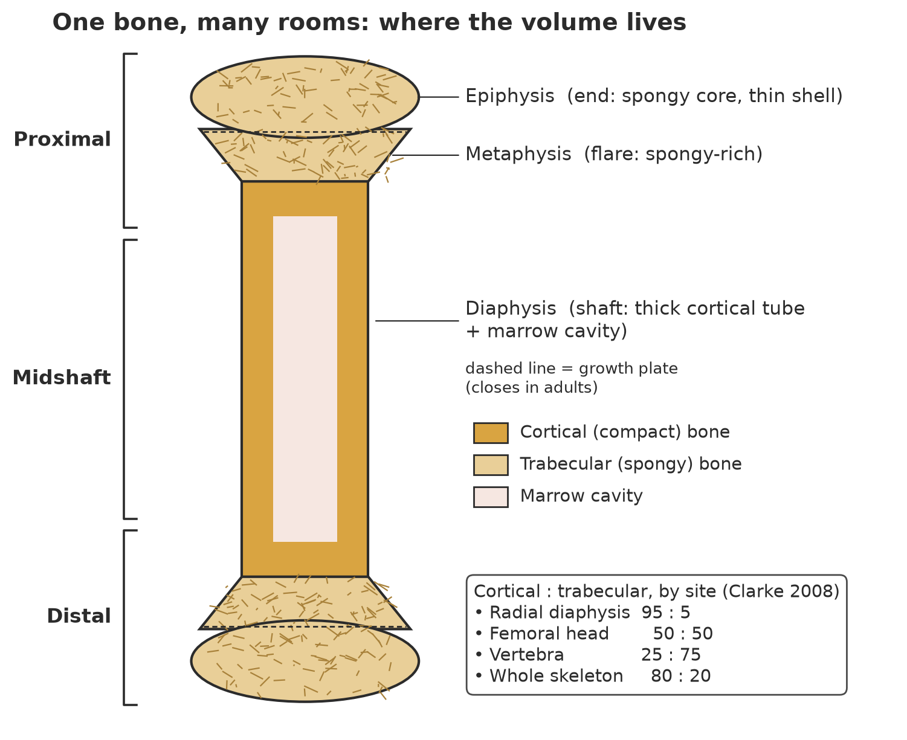
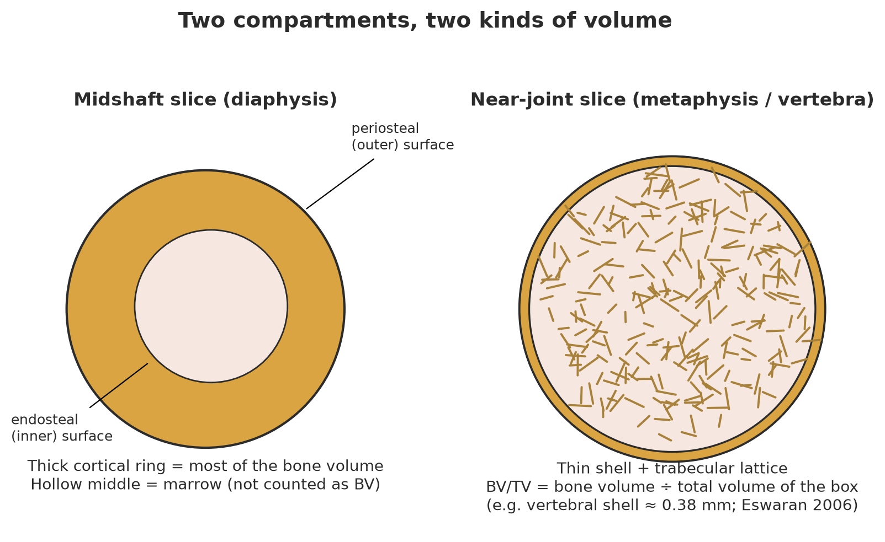
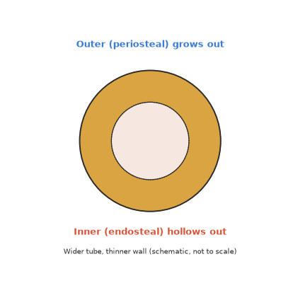
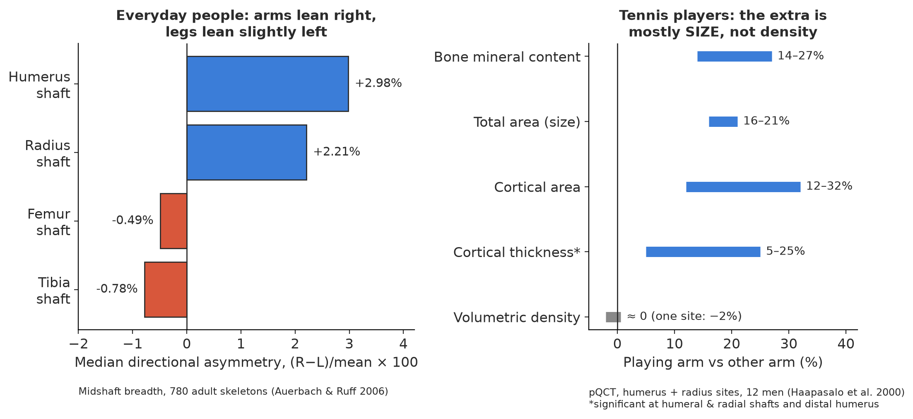

# Bone Volume, Room by Room: Sectors, Sides, and Sexes

**Theme 4 · Human Anatomy & Biology** · full draft v1 · 2026-11-01
**Audience:** universal (anyone curious about the real body). Accurate enough for specialists, but no stiff paper tone.
**Feeds:** body map overlays (`body-map/overlays/bone-volume-overlays.json`, `body-map/bone-volume-hover-notes.md`) and the library (`library/bone-metrics/`).
**Figures:** `figures/bone-volume/` · **Sources:** `sources/bone-volume-sources.md`

> **Map-first note.** Each section ends with a **🗺 Map panel** box. The box holds the short hover text and the numbers the overlay JSON uses, so map copy and paper never drift apart. Every number in a panel has a citation in [References](#8-references).

---

## 1. Hook

Bone is not one lump of "hard stuff."

Think of a bone as a house. It has rooms. Some rooms have thick stone walls. Some are filled with a light, airy scaffold. Volume lives in different *rooms* of the same bone. And the left house and the right house rarely match.

This paper walks through those rooms by **sector** (where along the bone), by **compartment** (shell or sponge), by **side** (left or right), and by **sex** (female or male). The short version: **volume is local and often lopsided.**

> 🗺 **Map panel: skeleton overview**
> *One bone, many rooms.* About 80% of adult skeletal bone is the dense outer kind (cortical) and 20% is the spongy inner kind (trabecular) [Clarke 2008].

---

## 2. What "volume" means here

The word "volume" hides several different measurements. Here are the main ones, each glossed in one line.

| Term | Plain meaning |
|---|---|
| **TV**, total (tissue) volume | The size of the box you drew around the bone region. |
| **BV**, bone volume | How much of that box is actually bone. |
| **BV/TV** | The share of the box that is bone. Example: 0.20 means one fifth bone and four fifths gaps. |
| **Ct.V**, cortical volume | Volume of the dense outer shell, also called compact bone. |
| **Tb.V**, trabecular volume | Volume of the inner lattice, also called spongy or cancellous bone. |
| **CSA / Tt.Ar / Ct.Ar** | Area of one slice: total area or cortical area. Stack many slices and you get a volume. |
| **Ct.Th** | Cortical thickness, meaning how thick the shell wall is. |
| **vBMD vs aBMD** | Mineral per cubic centimetre (true 3D density) vs mineral per square centimetre (a flattened 2D shadow). |

The abbreviations follow the standard nomenclature papers [Bouxsein 2010, a rodent μCT guide; Dempster 2013, a histomorphometry guide].

**Why the cousins matter.** A bone can get *bigger* (more TV) without getting *denser* (the same vBMD). A shell can get *wider* while its wall gets *thinner*. Size, amount and density are three different dials.

> 🗺 **Map panel: compartments** (`bone.compartment.xsec`)
> TV = the box. BV = the bone in the box. BV/TV = how full the box is. Shell = Ct.V; sponge = Tb.V.

---

## 3. Sector comparisons (same bone, different places)

*Figure 1. A long bone split two ways: proximal / midshaft / distal, and epiphysis / metaphysis / diaphysis. The inset gives cortical:trabecular ratios by site [Clarke 2008].*

### 3.1 Along the length: proximal, midshaft, distal

The idea first: **the ends are spongy and the middle is a tube.**

- The **diaphysis** (shaft) is a thick cortical cylinder around a marrow cavity.
- The **metaphysis** (the flare) and the **epiphysis** (the end) hold trabecular bone inside a thin cortical shell [Clarke 2008].

Now the concrete numbers. Cortical:trabecular ratios [Clarke 2008]:
- **radial diaphysis 95:5**
- **femoral head 50:50**
- **vertebra 25:75**

So the same skeleton runs from "almost all wall" to "mostly scaffold," depending on where you stand.

**Honest gap:** we found no solid published human table of Ct.V and Tb.V for each third (proximal / mid / distal) of whole long bones. Site ratios and single-slice pQCT data are the best available stand-ins.

### 3.2 Shell vs sponge: the compartment "sectors"

*Figure 2. A midshaft slice (thick ring, hollow middle) next to a near-joint slice (thin shell, lattice inside).*

The shell and the sponge play by different rules:

- **The sponge has more surface per volume, so it is remodelled faster** [Zebaze 2010]. More surface means more places for cells to dig and refill.
- **The shell is thin at the ends.** The vertebral cortical shell is about **0.38 ± 0.06 mm** thick and makes up 21–39% of vertebral bone mass (excluding endplates). At the narrowest section it carries up to **38–54%** of the load, but only about **15% near the endplates**, where the trabecular core takes **76–89%** [Eswaran 2006; finite-element models of 13 human vertebrae].
- **The cortex is where most bone is lost with age, measured in grams.** In the distal radius of 122 women, **68%** of the bone lost between ages 50 and 80 was cortical and **32%** trabecular. **84%** of that loss came after 65 [Zebaze 2010, HR-pQCT]. Cortical sites also account for about **80% of all fractures** (non-vertebral), per the same paper.

### 3.3 Two surfaces: periosteal vs endosteal envelopes

An **envelope** is a surface where bone cells can add or remove bone.
- **Periosteal:** the outside skin of the bone. Adding here makes the tube wider.
- **Endosteal (endocortical):** the inside wall facing the marrow. Removing here hollows the tube.

*Figure 4 (GIF). Schematic: the outer surface creeps out while the inner surface hollows out. The tube gets wider and the wall thinner.*

The evidence:
- **Bones widen with age.** Bone area rose about **15%** at central sites and about **16%** at peripheral sites across adult life, while cortical area fell slightly. The cortex "drifts outward" [Riggs 2004, QCT, 696 adults]. Subperiosteal expansion with age in the femur and tibia was described earlier in archaeological skeletons [Ruff & Hayes 1982].
- **The inner wall does much of the damage.** Remodelling of the cortex next to the marrow accounted for **47%** of the distal-radius bone loss [Zebaze 2010].
- **Thinning is patchy around the ring.** At the femoral neck in women, the superoposterior octant (one-eighth wedge of the cross-section) thinned **6.4% per decade**, and estimated critical stress fell **13.2% per decade**. Men showed smaller effects [Mayhew 2005, CT of 77 femurs].

> 🗺 **Map panels: sectors** (`bone.*.prox / mid / dist`)
> **Proximal / distal:** spongy core, thin shell. Femoral head ≈ 50:50 cortical:trabecular [Clarke 2008].
> **Midshaft:** thick tube. Radial shaft ≈ 95:5 [Clarke 2008].
> **Envelopes:** with age, bones widen outside (about +15–16% area) and hollow inside [Riggs 2004].

---

## 4. Side / laterality comparisons

*Figure 3. Left: median right-minus-left asymmetry in midshaft breadth in ordinary adults [Auerbach & Ruff 2006]. Right: playing arm vs other arm in former tennis players [Haapasalo 2000].*

### 4.1 Everyday people: arms lean right, legs barely lean

The asymmetry score is **%DA = (Right − Left) / mean × 100**. Positive means the right side is bigger. Across 780 adult skeletons [Auerbach & Ruff 2006]:

| Bone measure | Median %DA |
|---|---|
| Humerus midshaft breadth | **+2.98%** (men +3.35, women +2.29) |
| Radius midshaft breadth | **+2.21%** |
| Humerus length | +1.30% |
| Femur midshaft breadth | −0.49% |
| Tibia midshaft breadth | −0.78% |
| Femur length | −0.24% (about 1 mm) |
| Tibia length | 0.00% |

Takeaways:
- **Arms are lopsided, legs much less so.** 76% of people had a right-biased humeral shaft breadth. Many people went past 10% in the arm. Leg length asymmetry never passed a 0.71% median (about 2.5 mm) in any subgroup.
- **Shaft width is more lopsided than length or joint size.** Width responds to loading. Length is set mostly during growth.
- **"Crossed symmetry" exists:** a slight right-arm / left-leg tilt.
- **Left-handers can flip the pattern** in the hand bones (metacarpals) [Roy, Ruff & Plato 1994, cited in Auerbach & Ruff 2006].

**Caveat:** these are caliper breadths, which are an outside-size proxy, not measured volumes.

### 4.2 Athletes: the natural experiment

Racket and throwing sports give one arm far more load than the other, so the other arm acts as a built-in control.

- **Former tennis players** (12 men, pQCT) [Haapasalo 2000]. Playing arm vs other arm:
  - bone mineral content **+14–27%**
  - total area **+16–21%**
  - cortical area **+12–32%**
  - bone strength and bending indices (BSI, Imin, Imax) **+23–67%**

  Volumetric density was **about the same** between arms (one site differed by −2%). **The extra bone came from size, not density.** Matched controls showed small differences of about 3–6% in cortical area.
- **Youth tennis** (47 girls, DXA + MRI) [Bass 2002]:
  - In prepubertal players the loaded arm had **11–14%** more mineral content and torsional strength, and **7–11%** more cortical area.
  - Growth before puberty came mainly from **periosteal expansion** (outward growth).
  - Loading late in puberty mostly shrank the marrow cavity instead, which added little strength.
- **Baseball** (103 pro players vs 94 controls) [Warden 2014]:
  - Throwing nearly **doubled** humeral shaft strength.
  - After 50+ years of detraining, players kept **55.5%** of the size (total area) benefit and **33.7%** of the polar-moment (twisting strength) benefit.
  - The extra cortical mass and thickness were lost through medullary expansion.
  - In short: **size is remembered, wall thickness is not.**

### 4.3 The hip: left vs right on a DXA report

In 3,481 people scanned at both hips, left and right BMD correlated tightly (**r = 0.92–0.95**): mean femoral neck **0.859 (left) vs 0.865 (right) g/cm²**. Even so, the left-right difference exceeded the scanner's smallest detectable difference in **52–58%** of people, depending on the hip site. **7%** of people with osteopenic spines had osteoporosis in one hip [Mounach 2012]. A separate study of 384 postmenopausal women reported discordance in about 30% for the lowest hip T-score [Hwang 2012].

> 🗺 **Map panel: laterality** (`bone.laterality.arms`, `bone.laterality.legs`)
> **Arms:** right humeral shaft is about 3% wider on average; over 10% is not rare [Auerbach & Ruff 2006]. Tennis arm: +12–32% cortical area, same density [Haapasalo 2000].
> **Legs:** within about 1% in most people [Auerbach & Ruff 2006].
> **Hips:** both sides correlate strongly, but over half of people differ by more than the scanner's noise [Mounach 2012].

---

## 5. Sex differences in bone metrics

Here we cover bone numbers only. Hormones and the reproductive system are covered by other themes.

### 5.1 Peak bone mass: when and how much

- **Timing.** Total-body mineral content plateaus about 6 years after the growth spurt peak (peak height velocity): **around age 18 in girls and 20 in boys**. Bone *area* plateaus 1–2 years before bone *mineral*. Peak bone mass comes by the end of the second decade or early in the third, depending on site [Baxter-Jones 2011, longitudinal DXA].
- **The puberty window.** In the four years around the growth spurt, both sexes laid down about **39%** of young-adult total-body mineral. The figure was **33%** at the femoral neck in both sexes, and **43% (males) / 46% (females)** at the spine and total hip [Baxter-Jones 2011].

### 5.2 Size and geometry: men's bones are wider

- Young men had **35–42% larger bone cross-sectional areas** than young women at the spine, hip, wrist and ankle [Riggs 2004, QCT].
- Both sexes widen with age by similar amounts, about +15–16% [Riggs 2004].
- **Watch the trap:** a bigger bone looks "denser" on DXA even at the same true density. That is why size-adjusted measures such as BMAD exist [Carter 1992].

### 5.3 Cortical vs trabecular: different ageing stories

- **Trabecular density loss is large in both sexes and larger in women at central sites:** **−55% (women) vs −46% (men)** at spine and hip. At wrist and ankle it was about −24% vs −26% [Riggs 2004].
- **Cortical density loss:** about **−25% (women) vs −18% (men)** [Riggs 2004].
- **Same volume lost, different architecture.** At the wrist, young men started with **26% higher trabecular BV/TV** and **28% thicker trabeculae**. The number of trabeculae was similar. Over life, both sexes lost about the same share of BV/TV (**−27% women, −26% men**), but:
  - **women lost trabecular struts:** number −13%, spacing +24%;
  - **men mostly thinned them:** thickness −24% vs −18% in women [Khosla 2006, HR-pQCT, 602 adults].

  Losing struts weakens a lattice more than thinning them does. This may help explain why men largely avoid the age-related rise in wrist fractures.
- **Laterality differs a little by sex too.** Median humeral breadth asymmetry was +3.35% in men vs +2.29% in women [Auerbach & Ruff 2006].
- **Hip cortex:** age-related thinning of the superoposterior femoral neck was larger in women [Mayhew 2005].

> 🗺 **Map panel: sex layer** (female / male toggle on any bone)
> **Female:** peak total-body bone mineral around age 18. Ageing removes trabecular struts (number −13%) [Baxter-Jones 2011; Khosla 2006].
> **Male:** peak around age 20. Bones about 35–42% wider in cross-section. Ageing mainly thins struts (−24%) [Baxter-Jones 2011; Riggs 2004; Khosla 2006].

---

## 6. Light methods: why the number changes with the tool

| Tool | What it sees | Gives true volume? |
|---|---|---|
| **DXA** (dual X-ray) | A 2D shadow: mineral per cm² | No. It mixes size with density. |
| **QCT / pQCT** (calibrated CT, whole-body or limb) | 3D vBMD and areas; separates shell from sponge | Yes, by compartment |
| **HR-pQCT** (high-resolution limb CT; 89 µm voxels in Khosla 2006) | Trabecular number, thickness, porosity | Yes, at the wrist and ankle |
| **μCT** (micro-CT) | Very fine structure | Yes, but mostly on lab samples or animals |
| **MRI** | Marrow, and the bone outline by its "absence of signal" | Geometry yes; mineral no |

**Worked example, the tennis arm.** On DXA the playing arm "looks" much denser. On pQCT its true density is almost equal, and the difference is all size [Haapasalo 2000; Carter 1992]. Same bone, two tools, two stories.

**Second example: counting porosity.** Distal-radius cortical density fell **15%** when only the solid cortex was counted, but **43%** once pore space was counted as lost bone [Zebaze 2010].

---

## 7. Why it matters, and closing

- **Loading history is written in shape.** Shaft size remembers decades of use [Warden 2014].
- **Fracture risk is local.** Thin shells at the wrist and femoral neck, and lost struts in the sponge, matter more than one whole-body score [Zebaze 2010; Mayhew 2005; Khosla 2006].
- **Don't mistake asymmetry for disease.** A few percent of right-arm bias is normal. Hips can disagree, so scanning both sides changes the diagnosis for some people [Auerbach & Ruff 2006; Mounach 2012].
- **Compare like with like across sexes.** Use size-aware or volumetric measures [Riggs 2004; Carter 1992].

**Closing line:** *volume is local and often lopsided. Compare sectors, sides and sexes before treating a bone as a single number.*

### Figures
| # | File | Shows |
|---|---|---|
| F1 | `figures/bone-volume/bone-volume-sector-map.png` | Sectors + cortical:trabecular ratios |
| F2 | `figures/bone-volume/bone-volume-cortical-trabecular.png` | Shell vs sponge cross-sections |
| F3 | `figures/bone-volume/bone-volume-left-right.png` | Everyday %DA + tennis-arm gains |
| F4 | `figures/bone-volume/bone-volume-envelopes.gif` | Periosteal out, endosteal hollow (schematic) |

### Known gaps
- No published human whole-bone Ct.V/Tb.V table for each third of a long bone was found.
- Lower-limb *volumetric* (QCT) left–right data were not gathered for this draft; the leg numbers here are caliper breadths.
- The figure that the vertebral shell gives 38–68% of stiffness (a companion study) was not verified, so it is omitted.

---

## 8. References
Full list with DOIs: `sources/bone-volume-sources.md`.
Auerbach & Ruff 2006 · Bass et al. 2002 · Baxter-Jones et al. 2011 · Bouxsein et al. 2010 · Carter, Bouxsein & Marcus 1992 · Clarke 2008 · Dempster et al. 2013 · Eswaran et al. 2006 · Haapasalo et al. 2000 · Hwang et al. 2012 · Khosla et al. 2006 · Mayhew et al. 2005 · Mounach et al. 2012 · Riggs et al. 2004 · Roy, Ruff & Plato 1994 (secondary) · Ruff & Hayes 1982 · Warden et al. 2014 · Zebaze et al. 2010.
