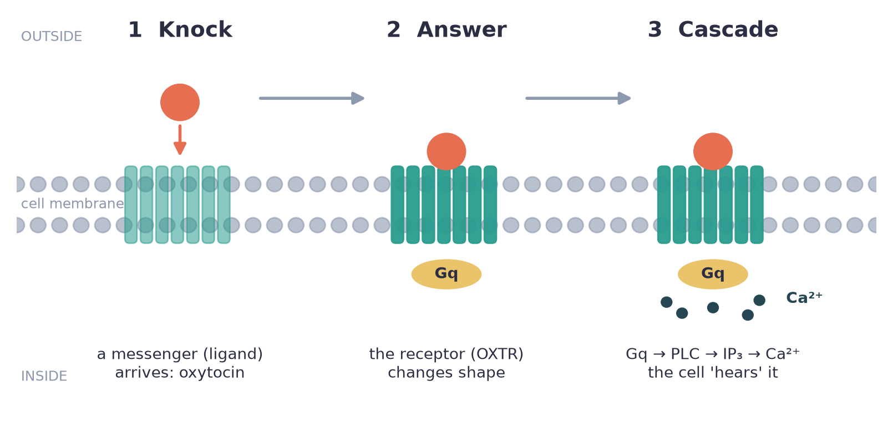
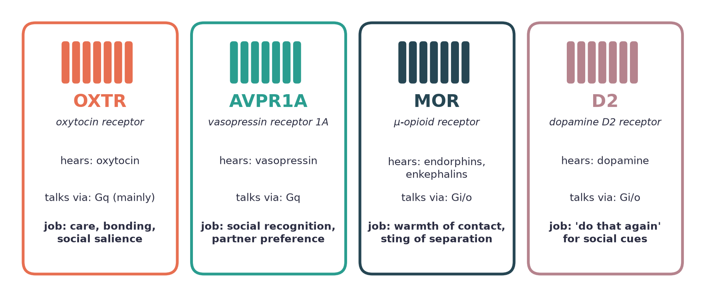
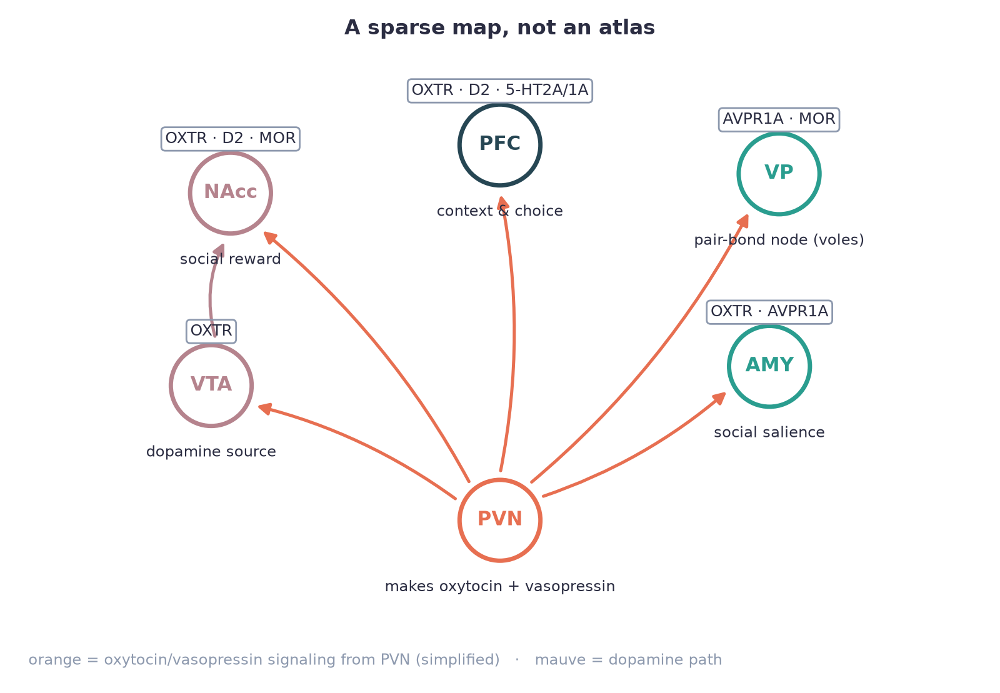
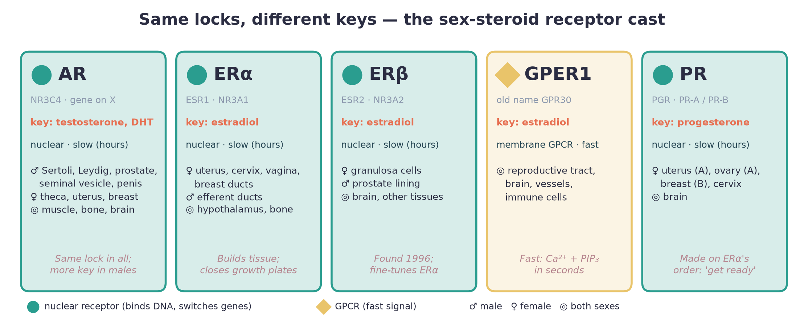
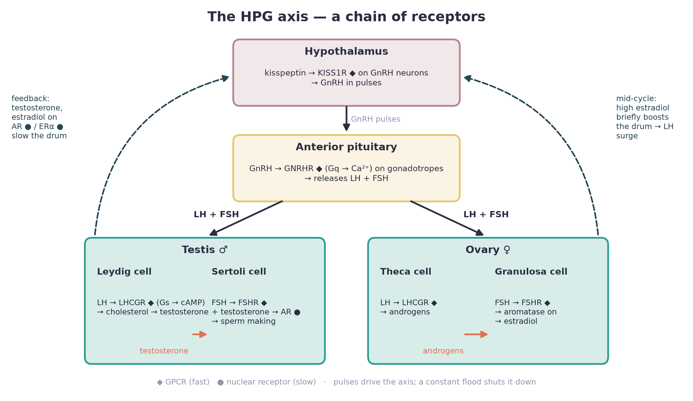

# Recreating Human Connections with Exact Receptor Knowledge

*Receptor-level human connections · White paper #1*

---
**Corpus Nova** · Theme 3 · Universal readers · PhD-worthy depth · Voice: alien-technology minimal · **License:** MIT · 2026-11-01

---
**Theme 3 · Receptor-level human connections · White paper #1**
**Audience:** everyone curious, from first-time readers to working scientists
**Status:** v2 (map-first + sex biology) · 2026-11-01
**Role:** 🗺️ **Map-content source.** This long read feeds the body-map panels and hovers (`body-map/overlays/receptors-overlays.json`, `body-map/overlays/receptors-sex-hormones-panel.md`) and the receptor cards (`library/receptors/`). Map region ids appear in `code` so editors can trace each claim to a hover.

> **One-line thesis:** Human connection is a receptor-shaped conversation. Messengers knock. Receptors answer. How many receptors you have, where they sit, and which version of the gene you carry rewrite the script.

---

**Part I — Connection receptors** (§1–6) · **Part II — Sex-steroid and reproductive receptors** (§7–11) · **Part III — Open edges and sources** (§12–13) · **Addendum — stress receptors MR/GR** (§14)

## 1. Opening — the conversation at the membrane

People say two friends "have chemistry." That's lazy, but it's not wrong.

Every hug, every shared laugh, every baby's cry that pulls a parent out of bed ends in the same tiny place: a **receptor**. A receptor is a protein that sits in a cell's outer skin (the **membrane**) and waits for one specific molecule. When that molecule arrives and fits, the receptor changes shape and tells the inside of the cell, "something happened."

The molecule that does the knocking is called a **ligand** (anything that binds a receptor). The ligands in this paper are mostly small brain messengers: oxytocin, vasopressin, endorphins, dopamine, and serotonin.

So here is the idea we'll chase:

- **Connection is not a mood floating in the air.** It's a dialogue between ligands and receptors in specific cells.
- **The receptor decides the meaning.** The same oxytocin molecule can make a uterus contract, a mother's ear tune in to her pup, or a reward circuit tag a partner as "special." Same knock, different door, different story.
- **"Exact" matters.** Which receptor subtype, how many copies, where on the cell, and which gene variant — those details are where people differ.

"Recreating" connection, in this paper, means three honest things: **measuring** that dialogue, **modeling** it, and — carefully — **restoring** it when it breaks. No love potions. No sci-fi.

*Figure 1. The three-beat rhythm of every receptor conversation in this paper. Shown for oxytocin and its receptor, OXTR.*

---

## 2. The core cast — receptor families that wire affiliation

Almost every receptor here belongs to one big family: **GPCRs** (G-protein–coupled receptors). Think of a GPCR as a doorbell wired to a small relay inside the cell, called a **G protein**. Different G proteins send different kinds of signal:

- **Gq** — "turn up": it activates an enzyme called PLC, which makes IP₃, which releases calcium (Ca²⁺) inside the cell. Calcium is the cell's all-purpose "go" signal.
- **Gi/o** — "turn down": it lowers a messenger called cAMP and usually quiets the cell.
- **Gs** — "turn up a different way": it raises cAMP.

Keep those three in mind. They are the grammar of the conversation.

*Figure 2. The headline cast. Serotonin receptors play a supporting role and are covered in brief below.*

### 2.1 Oxytocin receptor (OXTR) — the "this matters" amplifier

- **Ligand:** oxytocin, a 9-amino-acid peptide (a short protein chain) made mainly in the hypothalamus (a small region at the base of the brain that runs hormones).
- **Gene:** *OXTR*, on human chromosome 3.
- **Signal:** mainly **Gq → PLC → IP₃ → Ca²⁺**. It can also couple to Gi, depending on cell type and dose (Gimpl & Fahrenholz, 2001; Jurek & Neumann, 2018).
- **Where:** brain reward and emotion hubs (nucleus accumbens, amygdala, parts of cortex), plus the body — uterus, breast tissue, heart and blood vessels.

The pop label is "love hormone." The better label is **salience amplifier**: oxytocin makes social signals stand out from the noise. In mouse mothers, oxytocin acting in the hearing cortex makes pup cries "louder" to the brain by rebalancing inhibition, and that helps mothers learn to fetch lost pups (Marlin et al., 2015). Reviews now frame oxytocin as a tool for plasticity — the brain's ability to rewire — rather than a simple "be nice" switch (Froemke & Young, 2021).

### 2.2 Vasopressin receptors (AVPR1A, AVPR1B) — recognition and loyalty

- **Ligand:** arginine vasopressin (AVP), oxytocin's close cousin. The two peptides differ by only two amino acids.
- **AVPR1A (V1a):** Gq-coupled. In brain circuits it supports social recognition ("I know you") and, in some rodents, partner preference ("I choose you").
- **AVPR1B (V1b):** also Gq-coupled. Mostly sits in the pituitary (the hormone "master gland") and shapes the stress response. It's the link between stress and social behavior.
- (**AVPR2** is the kidney receptor that saves water. It is not part of the connection story.)

The landmark result: meadow voles normally don't pair up. Researchers boosted *Avpr1a* expression in one region, the **ventral pallidum** (a reward-output hub), and those males started to prefer one partner (Lim et al., 2004). One gene, one region, a new social style.

### 2.3 µ-opioid receptor (MOR, gene *OPRM1*) — warmth and the ache of loss

- **Ligands:** the body's own opioids — β-endorphin and enkephalins.
- **Signal:** **Gi/o** — it calms neurons down.
- **Where:** reward, pain and emotion circuits: striatum, thalamus, cingulate cortex, insula, amygdala.

MOR is where "feels good to be together" and "hurts to be apart" share hardware. Mouse pups lacking MOR cry less when separated from their mother and don't show a normal preference for her smell (Moles et al., 2004). In humans, PET scans show the opioid system responding to a partner's gentle touch (Nummenmaa et al., 2016) and to laughing with close friends (Manninen et al., 2017).

### 2.4 Dopamine D2/D3 — "do that again"

- **Ligand:** dopamine.
- **D2 and D3** are Gi/o-coupled. **D1** (Gs-coupled) is the opposite-direction partner.
- **Where:** the nucleus accumbens (NAcc), the brain's "worth repeating?" center, fed by dopamine neurons in the VTA (ventral tegmental area).

Dopamine doesn't make love. It **stamps** a cue as valuable so we come back to it. In prairie voles, *forming* a pair bond needs D2-type receptors in the NAcc. *Keeping* the bond (and pushing away strangers) later shifts toward D1-type receptors (Aragona et al., 2006). Same molecule, different receptor, different phase of a relationship.

### 2.5 Serotonin 5-HT1A / 5-HT2A — the mood lighting (brief)

Serotonin has at least 14 receptor subtypes. Two matter most here:

- **5-HT1A** (Gi/o) — tied to anxiety tone, including how threatening social situations feel.
- **5-HT2A** (Gq) — tied to perception, meaning, and self-experience.

In a human study, psilocybin (which acts mainly on 5-HT2A and 5-HT1A) reduced how excluded people felt after being left out of a game, and dampened the "social pain" response in the dorsal anterior cingulate cortex (Preller et al., 2016). In mice, oxytocin's social reward in the NAcc depends on serotonin acting at **5-HT1B** receptors (Dölen et al., 2013). Serotonin's deeper chemistry belongs to the Biology & Chemistry theme. Here it's the lighting, not the actor.

---

## 3. Where they sit — a body + brain map of connection

Receptors only matter where they are. A ligand that floats past a cell without the right receptor does nothing at all.

*Figure 3. A sparse map, not an atlas. The arrows are simplified; real wiring includes axon fibers, release from dendrites, and peptides drifting through tissue.*

**Brain hubs**

| Hub | Plain job | Key receptors |
|---|---|---|
| **PVN** (paraventricular nucleus of the hypothalamus) | The factory. Makes oxytocin and vasopressin. | Source of the ligands |
| **VTA** (ventral tegmental area) | Dopamine source | OXTR — oxytocin here boosts social reward (Hung et al., 2017) |
| **NAcc** (nucleus accumbens) | "Worth repeating?" | OXTR, D1/D2, MOR, 5-HT1B |
| **Ventral pallidum** | Reward output | AVPR1A, MOR |
| **Amygdala** | "Safe, special, or scary?" | OXTR, AVPR1A |
| **PFC** (prefrontal cortex) | Context and choice | OXTR (in some regions), D2, 5-HT2A/1A |
| **dACC / insula** (cingulate cortex and insula) | "Ouch" for physical and social pain | MOR |

**Body sites (the body listens too)**

- **Uterus:** OXTR drives contraction in labor. It's the textbook OXTR tissue.
- **Breast tissue:** OXTR on the cells around milk glands triggers milk let-down, which is part of feeding a baby.
- **Heart and vessels:** OXTR is present; oxytocin can affect heart rate and vessel tone (Gimpl & Fahrenholz, 2001; Jurek & Neumann, 2018).
- **Pituitary:** AVPR1B links vasopressin to the stress-hormone (ACTH/cortisol) response.

Human gene-expression maps show *OXTR* is richest in subcortical and smell-related regions, and it rises and falls in step with dopamine-related genes (Quintana et al., 2019). In other words, the connection receptors and the reward receptors tend to live next to each other.

These hubs feed the project's interactive body map: `body-map/overlays/receptors-overlays.json`. Map ids: `brain.pvn`, `brain.vta`, `brain.nacc`, `brain.ventral-pallidum`, `brain.amygdala`, `brain.pfc`, `brain.dacc-insula`, `brain.lateral-septum`, `heart`, `uterus`, `breast`.

---

## 4. What "exact" means

Two people can get the same hug and feel two different things. At the receptor level, there are at least six dials that can explain why.

1. **Subtype.** Vasopressin at AVPR1A (social memory) is a different message than vasopressin at AVPR1B (stress) or AVPR2 (kidney water). Naming "vasopressin" without the receptor is half a sentence.
2. **Density** — how many receptors a cell has. This is the volume knob. Prairie voles (which pair-bond) and meadow voles (which don't) differ sharply in where their OXTR and AVPR1A sit (Insel & Young, 2001; Young & Wang, 2004). Adding OXTR to the NAcc of prairie voles sped up partner preference, but the same boost did nothing in meadow voles (Ross et al., 2009). So density matters, but only inside the right circuit.
3. **Gene variants (polymorphisms)** — small common spelling differences in DNA.
   - In prairie voles, one non-coding SNP (a single-letter DNA difference) in *Oxtr* explained about 74% of the variation in striatal OXTR density and predicted bonding (King et al., 2016).
   - In humans, **OXTR rs53576**: GG carriers scored higher on empathy and lower on stress reactivity in one study (Rodrigues et al., 2009). But a large meta-analysis (a study that pools many studies) found no reliable effect on social behavior (Bakermans-Kranenburg & van IJzendoorn, 2014).
   - **AVPR1A RS3** is a repeat region in the gene's promoter (the stretch that controls how much gene gets read). One version, allele 334, was linked to lower partner bonding in men (Walum et al., 2008). Later replication work has been sobering (Jern et al., 2017).
   - **OPRM1 A118G** (rs1799971): G carriers reported more sensitivity to rejection and had a stronger dACC response (Way et al., 2009). A larger, preregistered study (490 people) didn't find it again (Persson et al., 2019).
4. **Trafficking** — whether receptors are on the surface or pulled inside the cell. After strong activation, GPCRs like OXTR are tagged and pulled in (internalized), so the cell gets temporarily "hard of hearing." Dose and timing change the message.
5. **Allostery** — molecules that bind a receptor somewhere other than the main pocket and nudge it up or down. For OXTR, magnesium and cholesterol both act this way (Gimpl & Fahrenholz, 2001).
6. **Co-expression and crosstalk.** Oxytocin can activate vasopressin receptors, and vasopressin can activate OXTR, especially at high doses (Song & Albers, 2018). OXTR in the NAcc works alongside dopamine and serotonin receptors in the same circuit (Dölen et al., 2013; Quintana et al., 2019). So the phenotype comes from a chord, not a single note.

**Lesson:** gene variants are a weak predictor of how a person connects. Region-specific receptor density and circuit context are much stronger. Same molecule, different person, different connection.

---

## 5. Recreating connection at receptor resolution

"Recreating" here means a loop: **measure → model → gently intervene → measure again.**

### 5.1 Measure

- **PET imaging** (a scan that tracks a radioactive tracer). For MOR it works well in living humans using the tracer [¹¹C]carfentanil. That's how touch and laughter were seen to engage the opioid system (Nummenmaa et al., 2016; Manninen et al., 2017). D2/D3 can be imaged too, with tracers such as [¹¹C]raclopride. **There's no validated OXTR PET tracer for people yet.** That's the single biggest measurement gap in the field.
- **Receptor autoradiography** (binding maps from tissue slices) in animals and post-mortem tissue. It's the classic way vole receptor maps were drawn.
- **Gene-expression atlases** (mRNA maps), like the Allen Human Brain Atlas used by Quintana et al. (2019).
- **Genetics** — useful for building hypotheses, but weak at predicting single people (Section 4).
- **Behavior and physiology** — partner-preference tests in voles; tasks like Cyberball (a ball-tossing game where you get left out) and trust games in humans.

### 5.2 Model

- **Binding level:** occupancy — what fraction of receptors are filled. Roughly, occupancy ≈ [L] / ([L] + K_d), where [L] is ligand concentration and K_d measures "stickiness" (lower K_d = stickier). Multiply by local density and G-protein efficiency and you get a first guess at signal strength in a region.
- **Circuit level:** combine the receptor maps with wiring. For example, oxytocin from the PVN → OXTR on VTA neurons → more dopamine to the NAcc (Hung et al., 2017).
- **Phase level:** bonds change over time. D2 matters for forming a bond and D1 for keeping it (Aragona et al., 2006). Models need a clock.

### 5.3 Gently intervene

- **Drugs that activate (agonists) or block (antagonists) receptors.** In animals, blockers placed in a specific region prove which receptor matters where. In humans, the most-used tool is **intranasal oxytocin** (a nose spray).
  - The famous early result: oxytocin increased trust in an investment game (Kosfeld et al., 2005).
  - The honest update: many intranasal studies have far too few participants to be reliable — estimated average power was about 16% in healthy volunteers (Walum, Waldman & Young, 2016). Effects depend strongly on the person and the situation (Bartz et al., 2011).
- **Context is part of the dose.** Oxytocin boosts *salience* (how much signals stand out). With a trusted partner that may mean warmth. Around a perceived outsider it can mean vigilance. Any intervention has to pair receptor action with a safe social setting.
- **Restoring, not installing.** The realistic goal is repair — for example where social reward is blunted, as studied in autism research, depression, or anhedonia (losing the ability to feel pleasure). Reviving the existing loop is the target, not creating new feelings.

See the library cards in `library/receptors/` for single-receptor summaries.

---

## 6. Worked examples

### 6.1 Pair bonding (prairie voles → humans)

- **Receptors:** OXTR (NAcc), AVPR1A (ventral pallidum), D2 → D1 (NAcc), MOR.
- **Story:** mating releases oxytocin, vasopressin, and dopamine. OXTR and D2 in the NAcc link the reward to *this* partner's smell and presence. AVPR1A in the ventral pallidum helps lock in the preference (Lim et al., 2004; Young & Wang, 2004). Later, D1 receptors increase and the bond shifts into "maintenance mode" — including rejecting strangers (Aragona et al., 2006).
- **Plot twist:** prairie voles with *Oxtr* deleted from birth (via CRISPR gene editing) still form pair bonds and raise pups. Their main problem is weaker milk let-down (Berendzen et al., 2023). Blocking OXTR quickly in adults disrupts bonding, but losing it from birth doesn't. That suggests the developing brain can route around the missing receptor. Rule of thumb: **receptors are critical paths, not irreplaceable ones.**

### 6.2 Parental care

- **Receptors:** OXTR (hearing cortex, NAcc, amygdala, breast tissue); MOR in the infant.
- **Parent side:** oxytocin acting on OXTR in the left auditory cortex of mouse mothers sharpens their response to pup calls and speeds up learning to retrieve pups (Marlin et al., 2015). In the body, OXTR on breast tissue cells drives milk let-down.
- **Infant side:** MOR helps the baby feel the bond. Without it, separation cries and preference for the mother fade (Moles et al., 2004).
- **Two-way loop:** the parent's OXTR and the child's MOR are two ends of the same conversation.

### 6.3 Empathy, social pain, and social loss

- **Receptors:** MOR (dACC, insula), 5-HT2A/1A, OXTR (amygdala).
- **Social pain** shares circuitry with physical pain. Being excluded activates the dACC (Eisenberger et al., 2003). MOR gene variation was linked to how strongly this happens (Way et al., 2009), though not consistently replicated.
- **Comfort** engages MOR too: touch and laughter trigger opioid release (Nummenmaa et al., 2016; Manninen et al., 2017).
- **Tone-setting:** 5-HT2A/1A stimulation dampened the feeling of exclusion (Preller et al., 2016). In some settings, oxytocin shifts how the amygdala weighs social cues.
- **Big picture:** losing someone is, in part, losing a reliable source of opioid and oxytocin signaling. Grief has receptor-level texture.

---

## 7. The second cast — sex-steroid receptors

So far our receptors have sat in the cell's outer skin and answered in seconds. The sex hormones mostly play a different game. Testosterone, estradiol (the main estrogen) and progesterone are **steroids**: fat-soluble molecules built from cholesterol. They slip straight through the membrane. Their receptors wait *inside* the cell.

Most of these inside receptors are **nuclear receptors**. A nuclear receptor is a protein that binds a hormone and then binds DNA itself, so it can switch genes on or off. They are slow (hours) but long-lasting. Think of the GPCR as a doorbell and the nuclear receptor as a renovation crew.

One big idea runs through this whole part:

> **Same locks, different keys.** Males and females carry mostly the same sex-hormone receptors. What differs is how much hormone arrives, which cells carry the receptor, and when.

*Figure 4. The sex-steroid cast. Round badge = nuclear receptor (slow, gene-switching). Diamond badge = membrane GPCR (fast).*

### 7.1 Androgen receptor (AR, NR3C4) — the testosterone lock, in everyone

**What it is.** AR is the nuclear receptor for testosterone and for DHT (dihydrotestosterone), a stronger form that some tissues make from testosterone using the enzyme 5α-reductase. DHT binds AR about twice as tightly and lets go about five times more slowly (Davey & Grossmann, 2016). The *AR* gene sits on the X chromosome, so males carry one copy and females two. Its official family code is **NR3C4** (nuclear receptor subfamily 3, group C, member 4).

**Slow route (genomic).** Without hormone, AR waits in the cell fluid, held by chaperones (helper proteins that keep it folded). Androgen binds. AR changes shape, pairs up, moves into the nucleus and grips **androgen response elements**. These are short DNA "address labels" near target genes. The genes' output changes over hours.

**Fast route (non-genomic).** AR can also act in seconds to minutes without touching DNA. It switches on kinase chains (relay enzymes such as Src and ERK) and opens a path for Ca²⁺ to enter (Davey & Grossmann, 2016). In the testis, Sertoli cells (the "nurse" cells around developing sperm) use both routes (Walker, 2011).

**Where it sits — male and female.**
- *Male:* Sertoli and Leydig cells, epididymis, prostate, seminal vesicles, erectile tissue, muscle, bone, skin, hypothalamus.
- *Female:* ovarian theca cells and early follicles, uterus, breast, muscle, bone, brain.
- The map of AR is broadly shared. The big sex difference is the **ligand**: adult men carry many times more circulating testosterone than women.

**The receptor beats the hormone.** In complete androgen insensitivity syndrome, a person with XY chromosomes makes normal or high testosterone, but AR doesn't work. The body develops along female lines (Hughes et al., 2012). No answer at the lock means no message, however loud the knock.

**Testosterone has a side door.** The enzyme aromatase turns testosterone into estradiol. So some "testosterone effects" actually run through *estrogen* receptors (Davey & Grossmann, 2016). Keep that in mind in §7.2.

### 7.2 Estrogen receptors α and β (ESR1, ESR2) — growth and fine-tuning

**ERα** (gene *ESR1*) and **ERβ** (gene *ESR2*) are two nuclear receptors for estradiol. ERβ was discovered late. It was cloned in 1996 from rat prostate and ovary and binds estradiol very tightly (Kuiper et al., 1996).

**Four ways to answer** (Hewitt & Korach, 2018):
1. **Genomic.** It binds estrogen response elements on DNA. "Pioneer" proteins such as FOXA1 first pry open the tightly packed DNA.
2. **Tethered.** It grabs another DNA-binding protein instead of DNA itself.
3. **Non-genomic.** A small membrane-linked pool fires fast kinase signals.
4. **Ligand-independent.** Growth-factor signals can switch the receptor on with no estrogen at all.

**Who sits where.**
- **ERα** dominates in the uterus, cervix, vagina, breast ducts and much of the hypothalamus and pituitary.
- **ERβ** leads in ovarian granulosa cells (the cells that wrap and feed each egg) and in prostate lining cells.
- Both sexes carry both receptors (Hewitt & Korach, 2018; Kuiper et al., 1996).

**Estrogen in males — two famous surprises.**
- *The fertility one.* Male mice without ERα can't reabsorb fluid in the efferent ducts, the tiny tubes leaving the testis. Sperm arrive diluted, and fertility falls (Hess et al., 1997).
- *The bone one.* A man with a broken ERα gene was very tall. His growth plates had never closed, and his bones were thin (Smith et al., 1994). In males, estrogen made from testosterone closes the growth plates.

### 7.3 GPER1 (formerly GPR30) — the fast estrogen receptor

GPER1 is a membrane GPCR, the same broad family as OXTR, that binds estradiol. When activated it raises Ca²⁺ and makes PIP₃ (a fast signalling lipid) within seconds. Much of it sits on the endoplasmic reticulum, the membrane system inside the cell, rather than on the surface (Revankar et al., 2005). It shows up in reproductive, brain, hormone, immune and blood-vessel tissue in both sexes (Prossnitz & Barton, 2011).

*Honest caveat:* in many tissues, scientists still argue over which fast estrogen effects need GPER1 and which come from membrane ERα. The map marks GPER1 as "present and active", not "in charge".

### 7.4 Progesterone receptor (PR, gene PGR) — "get ready, stay calm"

One gene, two versions: **PR-A** (shorter) and **PR-B** (longer). Both are nuclear receptors. Mouse genetics split their jobs neatly:
- Remove PR-A, and ovulation and uterine readiness fail. The breast is unaffected (Mulac-Jericevic et al., 2000).
- Remove PR-B, and ovary and uterus are fine. But the breast fails to branch during pregnancy, partly because the RANKL growth signal drops (Mulac-Jericevic et al., 2003).

ERα switches on the PR gene. So the estrogen half of the cycle builds the receptors the progesterone half will use. That relay is a neat example of receptor *density* as a dial, the same theme we saw with OXTR.

---

## 8. The drumbeat — brain-to-gonad receptors and how testosterone gets made

Sex hormones are made on request. The request travels down the **HPG axis**: **h**ypothalamus (brain) → **p**ituitary (a pea-sized gland under the brain) → **g**onads (testes or ovaries). At every step, the message is a hormone and the listener is a receptor.

*Figure 5. The HPG axis as a chain of receptors. Map ids: brain.hypothalamus.kiss-gnrh → pituitary.anterior → testis.leydig / testis.sertoli / ovary.follicle.*

### 8.1 KISS1R and GNRHR — ignition and drumbeat

**KISS1R** (kisspeptin receptor, old name GPR54) sits on GnRH neurons in the hypothalamus. Kisspeptin activates it, and the neurons release **GnRH** (gonadotropin-releasing hormone) in pulses. People with broken *KISS1R* don't go through puberty on their own. In mice lacking the receptor, the pituitary and gonads still respond when hormones are supplied from outside, so the block sits at the top of the chain (Seminara et al., 2003).

**GNRHR** sits on gonadotropes, the pituitary cells that make LH and FSH. It is a Gq GPCR, the same Gq → PLC → IP₃ → Ca²⁺ plan as OXTR. The human version is unusual: it lacks the C-terminal tail most GPCRs use to switch themselves off fast (Millar et al., 2004).

Rhythm is everything. *Pulses* of GnRH drive LH and FSH. A *constant* flood shuts the system down. Long-acting GnRH drugs use exactly this trick, for example in prostate cancer.

### 8.2 LHCGR and the Leydig cell — testosterone, step by step

**LHCGR** (luteinizing hormone/choriogonadotropin receptor) is a GPCR. It has a large outer "catcher's mitt" that grabs **LH**, or **hCG**, the pregnancy hormone. It signals mainly through Gs → cAMP (Ascoli et al., 2002). In the testis it sits on **Leydig cells**, which live between the sperm-making tubules.

How a Leydig cell turns an LH knock into testosterone (Zirkin & Papadopoulos, 2018):
1. LH binds LHCGR → cAMP rises → PKA (a cAMP-driven enzyme) switches on.
2. Cholesterol is moved into the mitochondria (the cell's power units). StAR and a protein complex that includes TSPO do the moving. **This is the slow step that sets the pace.**
3. The enzyme CYP11A1 cuts cholesterol into pregnenolone.
4. Enzymes in the smooth endoplasmic reticulum finish the job: pregnenolone → testosterone.

There are two Leydig generations. Fetal Leydig cells make the androgen surge that builds male genitals and masculinizes the brain. Adult Leydig cells grow from stem cells after birth, power puberty, and rarely turn over. Testosterone output declines in many ageing men (Zirkin & Papadopoulos, 2018).

### 8.3 FSHR and AR in the Sertoli cell — where testosterone is used

**FSHR** (follicle-stimulating hormone receptor) is LHCGR's cousin. It is also a Gs GPCR, and it is found almost only in the gonads (Simoni et al., 1997). In the testis it sits on **Sertoli cells**, next to AR.

Here's the twist. Testosterone supports sperm making mainly through the **Sertoli cell's AR**, not through receptors on the sperm cells (Walker, 2011). Remove AR from Sertoli cells alone in mice, and sperm making stops partway through meiosis, the special cell division that makes sperm (De Gendt et al., 2004).

### 8.4 The ovary's two-cell, two-receptor trick

The ovary uses the same receptors, split across two cell types (Richards & Pangas, 2010):
- **Theca cells**: LH → LHCGR → androgens. Yes, ovaries make androgens.
- **Granulosa cells**: FSH → FSHR → aromatase on → those androgens become estradiol.
- Near ovulation, granulosa cells also gain LHCGR. The LH surge then triggers ovulation, and PR (the PR-A form in mice) becomes essential (Mulac-Jericevic et al., 2000).
- After ovulation the follicle becomes the **corpus luteum**, a temporary gland. LHCGR keeps it making progesterone. In early pregnancy the embryo's hCG rings the same receptor to keep it alive.

Steroids then flow back up the chain. Testosterone and estradiol act on hypothalamic and pituitary receptors (including AR and ERα) to slow the drumbeat. This is **feedback**. Females add a mid-cycle switch where rising estradiol briefly *boosts* the drumbeat, producing the LH surge.

---

## 9. Male receptor map

Each row is a region on the map. Ids match `body-map/overlays/receptors-overlays.json` (`sex: "male"`).

| Map id | Place | Receptors | What they do |
|---|---|---|---|
| `testis.leydig` | Leydig cells | LHCGR, AR | LH → cAMP → testosterone |
| `testis.sertoli` | Sertoli cells | FSHR, AR | nurse sperm; AR needed to finish meiosis |
| `epididymis` | Efferent ducts + epididymis | ERα, AR | ERα soaks up fluid so sperm leave concentrated |
| `prostate` | Prostate | AR, ERβ, ERα | DHT via AR drives growth and secretion; ERβ in the lining cells |
| `seminal-vesicle` | Seminal vesicles | AR | androgen-dependent fluid making |
| `penis.corpus-cavernosum` | Erectile tissue | soluble guanylyl cyclase (the NO receptor), α1-adrenoceptors, AR | NO → cGMP → muscle relaxes → blood fills; α1 keeps it flaccid |

**Erectile tissue, receptor-exactly.** Nerves and blood-vessel lining release nitric oxide (NO). NO's receptor is **soluble guanylyl cyclase**, an enzyme inside the muscle cell that makes cGMP. cGMP relaxes the smooth muscle, so blood rushes in. At rest, noradrenaline acting on **α1-adrenoceptors** keeps the muscle contracted. PDE5, the target of common erectile-dysfunction pills, is an enzyme that breaks down cGMP. It is not a receptor (Andersson, 2011).

---

## 10. Female receptor map

Ids match the overlay file (`sex: "female"`). Female meshes come from the HRA female body in slorksmo/Human-Atlas.

| Map id | Place | Receptors | What they do |
|---|---|---|---|
| `ovary.follicle.theca` | Theca cells | LHCGR, AR | LH → androgens (raw material for estrogen) |
| `ovary.follicle.granulosa` | Granulosa cells | FSHR, LHCGR (late), ERβ, PR (after the LH surge) | follicle growth, estradiol, ovulation |
| `ovary.corpus-luteum` | Corpus luteum | LHCGR | progesterone; hCG rescue in pregnancy |
| `fallopian-tube` | Uterine tube | ERα, PR | tune egg transport |
| `uterus.endometrium` | Lining | ERα, PR-A/B, GPER1 | build (ERα), make ready for an embryo (PR) |
| `uterus.myometrium` | Muscle wall | OXTR, PR, ERα | OXTR peaks in early labor; PR keeps the muscle quiet before that |
| `cervix` | Cervix | ERα, PR | thin, sperm-friendly mucus (ERα) vs thick, gate-closed mucus (PR) |
| `vagina` | Vagina | ERα | thick, moist lining; thins after menopause |
| `breast` | Mammary gland | ERα, PR-B, OXTR | grow ducts, branch them, squeeze out milk |

**OXTR ties the two casts together.** In the uterus, OXTR numbers climb through pregnancy and peak in early labor (Fuchs et al., 1982). In the breast, OXTR on the muscle-like cells around milk glands squeezes milk out at let-down (Gimpl & Fahrenholz, 2001). In the brain, estradiol can raise OXTR in some regions (Champagne et al., 2001). One receptor serves birth, feeding and bonding.

---

## 11. Sex differences in the connection receptors

This is where it's easy to say too much. Here is what the evidence supports:

- **Oxytocin and vasopressin receptors.** In rodents, receptor binding differs between males and females in specific brain regions, and the same drug can have different, sometimes opposite, behavioural effects by sex. There's no blanket "more in one sex" (Dumais & Veenema, 2016).
- **Steroids set connection receptors.** In female rats, estradiol raises OXTR in the medial preoptic area and lateral septum. Mothers who lick and groom their pups more show more of this estrogen-boosted OXTR. Blocking OXTR erases the difference (Champagne et al., 2001). Map ids: `brain.mpoa`, `brain.lateral-septum`.
- **µ-opioid receptor.** In a PET study at matched pain intensity, men showed more MOR system activation in regions such as the anterior thalamus, ventral pallidum and amygdala. Women showed *reduced* activation in the nucleus accumbens (Zubieta et al., 2002). Direction, not just size, differed by region.
- **What we can't say yet.** Many human receptor-imaging studies of touch and laughter tested only men (§12). There's still no human OXTR PET tracer. So human sex-difference claims about OXTR density remain open.

---

## 12. Open edges

- **Species translation.** Voles, mice, and humans differ in where their receptors sit. A finding in the vole ventral pallidum isn't automatically a human fact. Without an OXTR PET tracer, we can't yet check density in living people.
- **Sex differences.** Vasopressin and oxytocin systems differ by sex in receptor density and behavioral effects, often with region-specific patterns (Dumais & Veenema, 2016). Many human PET studies of touch and laughter tested only men. Details in §11.
- **Crosstalk.** OXT↔AVPR1A and AVP↔OXTR cross-binding makes "which receptor did it?" a hard question, especially with high-dose sprays (Song & Albers, 2018).
- **Development vs. acute action.** The CRISPR vole result (Berendzen et al., 2023) says early loss can be compensated. What does the backup route run on?
- **Replication.** Candidate-gene findings (rs53576, RS3, A118G) mostly shrank when tested in larger samples. The future lies in big, preregistered studies (where methods are fixed in advance) plus region-specific expression data.
- **Ethics of "tuning" affiliation.** Changing how strongly someone bonds raises questions of consent, coercion, and who decides what "healthy" connection looks like. The defensible scope is therapeutic restoration, done with consent and in context.
- **Atlas resolution.** The map's meshes stop at organs. Brain nuclei (PVN, VTA, MPOA) and cell types (Leydig, Sertoli, granulosa) are *hotspots* pinned on a parent mesh, not true 3D shapes. Receptor maps are finer than the atlases we borrow.
- **Human receptor maps for sex steroids.** Most cell-level receptor facts (Sertoli-only AR knockout, ERα efferent ducts, PR-A vs PR-B) come from mice. Human rare-variant cases (androgen insensitivity, ERα loss, *KISS1R* loss) back up the main ones, but most details aren't yet confirmed in people.
- **Sex is more than two bodies.** The map offers male and female reference bodies because the atlases do. Real people include intersex variations (AIS is one, §7.1), hormone therapy, pregnancy and menopause. All of these change receptor *occupancy* (how many receptors have a hormone bound) without changing the map's meshes. Overlays should say "typical", not "normal".
- **Ethics of the sex layer.** Receptor biology explains mechanism. It doesn't rank bodies or prescribe behavior. Hormone dosing belongs with clinicians and the hormones theme, not in a hover panel.

---

## 13. Sources

*All verified via web search on 2026-11-01. Full index: `sources/receptors-sources.md`.*

1. Andersson KE (2011). Mechanisms of penile erection and basis for pharmacological treatment of erectile dysfunction. *Pharmacological Reviews* 63(4):811–859. PMID 21880989.
2. Aragona BJ, Liu Y, Yu YJ, Curtis JT, Detwiler JM, Insel TR, Wang Z (2006). Nucleus accumbens dopamine differentially mediates the formation and maintenance of monogamous pair bonds. *Nature Neuroscience* 9:133–139.
3. Ascoli M, Fanelli F, Segaloff DL (2002). The lutropin/choriogonadotropin receptor, a 2002 perspective. *Endocrine Reviews* 23(2):141–174. PMID 11943741.
4. Bakermans-Kranenburg MJ, van IJzendoorn MH (2014). A sociability gene? Meta-analysis of oxytocin receptor genotype effects in humans. *Psychiatric Genetics* 24:45–51.
5. Bartz JA, Zaki J, Bolger N, Ochsner KN (2011). Social effects of oxytocin in humans: context and person matter. *Trends in Cognitive Sciences* 15:301–309.
6. Berendzen KM, Sharma R, Mandujano MA, et al. (2023). Oxytocin receptor is not required for social attachment in prairie voles. *Neuron* 111:787–796.
7. Champagne F, Diorio J, Sharma S, Meaney MJ (2001). Naturally occurring variations in maternal behavior in the rat are associated with differences in estrogen-inducible central oxytocin receptors. *PNAS* 98(22):12736–12741. PMID 11606726.
8. Davey RA, Grossmann M (2016). Androgen receptor structure, function and biology: from bench to bedside. *Clinical Biochemist Reviews* 37(1):3–15. PMID 27057074.
9. De Gendt K, Swinnen JV, Saunders PT, et al. (2004). A Sertoli cell-selective knockout of the androgen receptor causes spermatogenic arrest in meiosis. *PNAS* 101(5):1327–1332. PMID 14745012.
10. Dumais KM, Veenema AH (2016). Vasopressin and oxytocin receptor systems in the brain: sex differences and sex-specific regulation of social behavior. *Frontiers in Neuroendocrinology* 40:1–23.
11. Dölen G, Darvishzadeh A, Huang KW, Malenka RC (2013). Social reward requires coordinated activity of nucleus accumbens oxytocin and serotonin. *Nature* 501:179–184.
12. Eisenberger NI, Lieberman MD, Williams KD (2003). Does rejection hurt? An fMRI study of social exclusion. *Science* 302:290–292.
13. Froemke RC, Young LJ (2021). Oxytocin, neural plasticity, and social behavior. *Annual Review of Neuroscience* 44:359–381.
14. Fuchs AR, Fuchs F, Husslein P, Soloff MS, Fernström MJ (1982). Oxytocin receptors and human parturition: a dual role for oxytocin in the initiation of labor. *Science* 215(4538):1396–1398. PMID 6278592.
15. Gimpl G, Fahrenholz F (2001). The oxytocin receptor system: structure, function, and regulation. *Physiological Reviews* 81:629–683.
16. Hess RA, Bunick D, Lee KH, et al. (1997). A role for oestrogens in the male reproductive system. *Nature* 390(6659):509–512. PMID 9393999.
17. Hewitt SC, Korach KS (2018). Estrogen receptors: new directions in the new millennium. *Endocrine Reviews* 39(5):664–675. PMID 29901737.
18. Hughes IA, Davies JD, Bunch TI, Pasterski V, Mastroyannopoulou K, MacDougall J (2012). Androgen insensitivity syndrome. *Lancet* 380(9851):1419–1428. PMID 22698698.
19. Hung LW, Neuner S, Polepalli JS, et al. (2017). Gating of social reward by oxytocin in the ventral tegmental area. *Science* 357:1406–1411.
20. Insel TR, Young LJ (2001). The neurobiology of attachment. *Nature Reviews Neuroscience* 2:129–136.
21. Jern P, Verweij KJH, Barlow FK, Zietsch BP (2017). Reported associations between receptor genes and human sociality are explained by methodological errors and do not replicate. *PNAS* 114(44):E9882.
22. Jurek B, Neumann ID (2018). The oxytocin receptor: from intracellular signaling to behavior. *Physiological Reviews* 98:1805–1908.
23. King LB, Walum H, Inoue K, Eyrich NW, Young LJ (2016). Variation in the oxytocin receptor gene predicts brain region–specific expression and social attachment. *Biological Psychiatry* 80:160–169.
24. Kosfeld M, Heinrichs M, Zak PJ, Fischbacher U, Fehr E (2005). Oxytocin increases trust in humans. *Nature* 435:673–676.
25. Kuiper GG, Enmark E, Pelto-Huikko M, Nilsson S, Gustafsson JA (1996). Cloning of a novel receptor expressed in rat prostate and ovary. *PNAS* 93(12):5925–5930. PMID 8650195.
26. Lim MM, Wang Z, Olazábal DE, Ren X, Terwilliger EF, Young LJ (2004). Enhanced partner preference in a promiscuous species by manipulating the expression of a single gene. *Nature* 429:754–757.
27. Manninen S, Tuominen L, Dunbar RI, et al. (2017). Social laughter triggers endogenous opioid release in humans. *Journal of Neuroscience* 37:6125–6131.
28. Marlin BJ, Mitre M, D'amour JA, Chao MV, Froemke RC (2015). Oxytocin enables maternal behaviour by balancing cortical inhibition. *Nature* 520:499–504.
29. Millar RP, Lu ZL, Pawson AJ, Flanagan CA, Morgan K, Maudsley SR (2004). Gonadotropin-releasing hormone receptors. *Endocrine Reviews* 25(2):235–275. PMID 15082521.
30. Moles A, Kieffer BL, D'Amato FR (2004). Deficit in attachment behavior in mice lacking the µ-opioid receptor gene. *Science* 304:1983–1986.
31. Mulac-Jericevic B, Lydon JP, DeMayo FJ, Conneely OM (2003). Defective mammary gland morphogenesis in mice lacking the progesterone receptor B isoform. *PNAS* 100(17):9744–9749. PMID 12897242.
32. Mulac-Jericevic B, Mullinax RA, DeMayo FJ, Lydon JP, Conneely OM (2000). Subgroup of reproductive functions of progesterone mediated by progesterone receptor-B isoform. *Science* 289(5485):1751–1754. PMID 10976068.
33. Nummenmaa L, Tuominen L, Dunbar R, et al. (2016). Social touch modulates endogenous µ-opioid system activity in humans. *NeuroImage* 138:242–247.
34. Persson E, Asutay E, Heilig M, Löfberg A, Pedersen N, Västfjäll D, Tinghög G (2019). Variation in the µ-opioid receptor gene (OPRM1) does not moderate social-rejection sensitivity in humans. *Psychological Science* 30:1050–1062.
35. Preller KH, Pokorny T, Hock A, et al. (2016). Effects of serotonin 2A/1A receptor stimulation on social exclusion processing. *PNAS* 113:5119–5124.
36. Prossnitz ER, Barton M (2011). The G-protein-coupled estrogen receptor GPER in health and disease. *Nature Reviews Endocrinology* 7(12):715–726. PMID 21844907.
37. Quintana DS, Rokicki J, van der Meer D, et al. (2019). Oxytocin pathway gene networks in the human brain. *Nature Communications* 10:668.
38. Revankar CM, Cimino DF, Sklar LA, Arterburn JB, Prossnitz ER (2005). A transmembrane intracellular estrogen receptor mediates rapid cell signaling. *Science* 307(5715):1625–1630. PMID 15705806.
39. Richards JS, Pangas SA (2010). The ovary: basic biology and clinical implications. *Journal of Clinical Investigation* 120(4):963–972. PMID 20364094.
40. Rodrigues SM, Saslow LR, Garcia N, John OP, Keltner D (2009). Oxytocin receptor genetic variation relates to empathy and stress reactivity in humans. *PNAS* 106:21437–21441.
41. Ross HE, Freeman SM, Spiegel LL, Ren X, Terwilliger EF, Young LJ (2009). Variation in oxytocin receptor density in the nucleus accumbens has differential effects on affiliative behaviors in monogamous and polygamous voles. *Journal of Neuroscience* 29:1312–1318.
42. Seminara SB, Messager S, Chatzidaki EE, et al. (2003). The GPR54 gene as a regulator of puberty. *New England Journal of Medicine* 349(17):1614–1627. PMID 14573733.
43. Simoni M, Gromoll J, Nieschlag E (1997). The follicle-stimulating hormone receptor: biochemistry, molecular biology, physiology, and pathophysiology. *Endocrine Reviews* 18(6):739–773. PMID 9408742.
44. Smith EP, Boyd J, Frank GR, et al. (1994). Estrogen resistance caused by a mutation in the estrogen-receptor gene in a man. *New England Journal of Medicine* 331(16):1056–1061. PMID 8090165.
45. Song Z, Albers HE (2018). Cross-talk among oxytocin and arginine-vasopressin receptors: relevance for basic and clinical studies of the brain and periphery. *Frontiers in Neuroendocrinology* 51:14–24.
46. Walker WH (2011). Testosterone signaling and the regulation of spermatogenesis. *Spermatogenesis* 1(2):116–120. PMID 22319659.
47. Walum H, Waldman ID, Young LJ (2016). Statistical and methodological considerations for the interpretation of intranasal oxytocin studies. *Biological Psychiatry* 79:251–257.
48. Walum H, Westberg L, Henningsson S, et al. (2008). Genetic variation in the vasopressin receptor 1a gene (AVPR1A) associates with pair-bonding behavior in humans. *PNAS* 105:14153–14156.
49. Way BM, Taylor SE, Eisenberger NI (2009). Variation in the µ-opioid receptor gene (OPRM1) is associated with dispositional and neural sensitivity to social rejection. *PNAS* 106:15079–15084.
50. Young LJ, Wang Z (2004). The neurobiology of pair bonding. *Nature Neuroscience* 7:1048–1054.
51. Zirkin BR, Papadopoulos V (2018). Leydig cells: formation, function, and regulation. *Biology of Reproduction* 99(1):101–111. PMID 29566165.
52. Zubieta JK, Smith YR, Bueller JA, et al. (2002). µ-Opioid receptor-mediated antinociceptive responses differ in men and women. *Journal of Neuroscience* 22(12):5100–5107. PMID 12077205.

*Optional motion figure:* `../figures/receptors/receptors-oxtr-path.gif` — a looping knock → Gq → Ca²⁺ pulse.

---

## 14. Addendum: stress receptors MR and GR (cortisol)

*Added 2026-11-02. This section is lean on purpose. The chemistry and every number belong to BioChem's cortisol pack (`notes/stress-axis-cortisol.md`, white paper 01 §7.8), and the brain effects belong to Mind (`library/mind/cortisol-brain-effects.md`). Sources: `sources/receptors-sources.md` §F.*

Connection runs on stress, too. When the stress axis fires, the adrenal releases **cortisol** (corticosterone in rodents), and the brain reads it with two nuclear receptors from the same family as AR and PR (§7):

- **MR (`NR3C2`), the pilot light.** **RAT:** it binds corticosterone very tightly (Kd ≈ 0.5 nM), sits mainly in the hippocampus and lateral septum, and is about **90%** occupied even at the daily trough (Reul & de Kloet, 1985). Card: `library/receptors/mr.md`.
- **GR (`NR3C1`), the alarm bell.** **RAT:** it binds 6–10× more weakly (Kd ≈ 2.5–5 nM), spreads more widely through the brain (PVN included), and fills at the diurnal peak or under stress (Reul & de Kloet, 1985). Card: `library/receptors/gr.md`.
- **The switch.** Together the pair acts as a "binary" master switch for neuronal and network adaptation (de Kloet, Joëls & Holsboer, 2005, review).

Where it shows up on the map: `brain.hippocampus` (confirmed hotspot; stress-timed memory retrieval, **RAT** and **HUMAN**), `brain.pfc` (stress → control, **RAT** and **HUMAN**), `brain.pvn`, and the source at `abdomen.adrenal`. Panel copy: `body-map/overlays/receptors-stress-axis-panel.md`.

### 14.1 Kidney periphery: same lock, different doorman

MR binds aldosterone and cortisol with equal affinity (**RAT** + recombinant, Funder et al. 1988; **HUMAN** recombinant, Hellal-Levy et al. 2000). In the distal nephron, the enzyme **11β-HSD2** (`HSD11B2`) turns cortisol into cortisone first (Km for cortisol 47 nM, **HUMAN** recombinant; Albiston et al. 1994; location **HUMAN**, Krozowski et al. 1995), so kidney MR hears aldosterone. When the gate fails, cortisol acts like aldosterone (AME, **HUMAN**; Mune et al. 1995). Cards: `library/receptors/mr-kidney.md` · `library/receptors/hsd11b2.md`. Sources: `sources/receptors-kidney-mr-hsd11b2.md`. Map: `abdomen.kidney` (pending Whole Body confirm).

**Open edge.** Human MR/GR Kd, occupancy and brain density, and cortisol levels inside human hippocampus or PFC are **UNSOURCED**. Every *brain* affinity number above is from rats. For the kidney, native human tissue Kd, MR density, measured occupancy and intrarenal steroid levels remain **UNSOURCED**; the human Kd/Km values in §14.1 are from recombinant protein.

*Figures:* none yet. A two-lock "pilot light vs alarm bell" occupancy sketch is a candidate for `figures/receptors/`, but it must use the RAT numbers only.

---
**License:** MIT — © 2026 Corpus Nova contributors. See `/LICENSE`. Third-party atlas meshes retain their own licenses.
