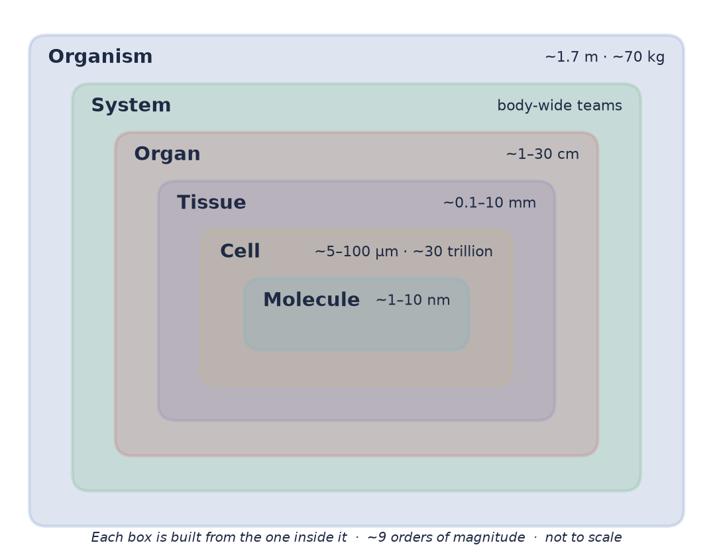
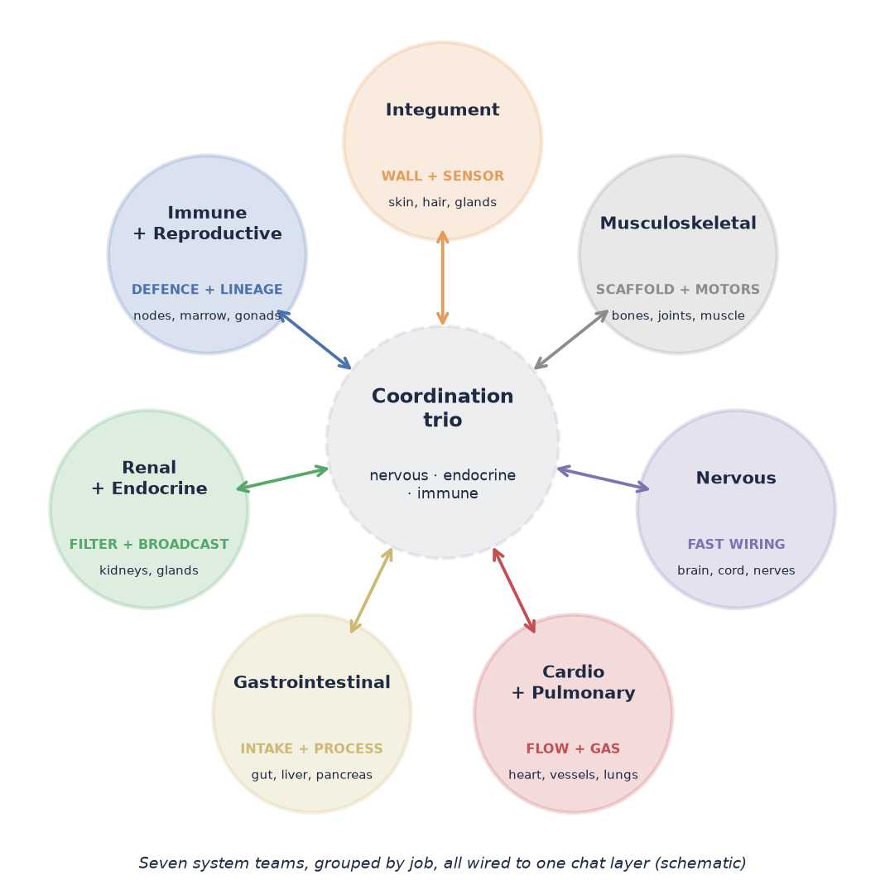
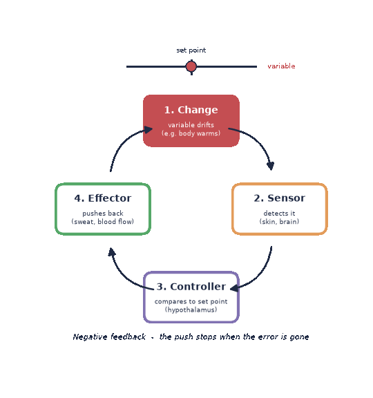

# The Body as One Map: Nested Systems from Skin to Signal

*Human Anatomy & Biology project · Whole Body · White paper 1 · Draft v3 (map-first + sex biology)*

---
**Corpus Nova** · Theme 6 · Universal readers · PhD-worthy depth · Voice: alien-technology minimal · **License:** MIT · 2026-11-01

---
*For: anyone curious about the real human body, from first-year students to working scientists.*

---

## Abstract

A human body is a set of boxes inside boxes. It keeps itself alive by trading matter, energy, and information across every box wall. This paper is a flyover of that stack: the organ systems, the jumps in scale, and the three big coordinators (nervous, endocrine, immune) that keep roughly 30 trillion cells working as one organism. Think of it as the map on the wall. The paper is written **map-first**: every place it describes becomes a hover payload on the interactive body map (§6), with a shared base and equal-depth male and female layers. The sibling papers and the library zoom in on single streets.

---

## 1. Opening frame: an open system with a strong wall

Start abstract. A body is a *far-from-equilibrium* system: it is never "settled," the way a cup of coffee settles to room temperature. It stays ordered only by constantly taking in energy and throwing out *entropy* (disorder), as heat, CO₂, water, and waste. Stop the flow and the order goes away. That is what death looks like to a physicist.

So anatomy is not just a parts list. It is the plumbing and wiring of a **flow machine**. Every system in this paper does one or more of four jobs:

1. **Wall** — keep inside and outside separate.
2. **Move** — push matter around: blood, air, food, urine, the body itself.
3. **Swap** — exchange things across a thin surface (lung, gut, kidney, placenta).
4. **Talk** — send information so the other three stay in sync.

The fun twist is that the body is "closed-ish." It is very open to energy and matter. But it is fiercely closed about its *internal* conditions. Claude Bernard called this the *milieu intérieur*: the inner fluid bath that cells actually live in [1]. Walter Cannon later named its stability **homeostasis** [2, 3]. Keep that idea in your pocket. We will come back to it in Section 5.

---

## 2. The scale ladder: molecule → organism in one pass

Biology spans roughly nine *orders of magnitude* (factors of ten) in length, from nanometres (billionths of a metre) to metres. Each rung is made of the rung below. Each rung also gains new behaviour the rung below does not have.

| Rung | Typical size | One-line gloss | New trick at this rung |
|---|---|---|---|
| Molecule | ~1–10 nm | Proteins, lipids, nucleic acids, ions | Shape-based chemistry |
| Cell | ~5–100 µm (neurons and muscle fibres much longer) | The smallest unit that is alive by itself | Self-copying, metabolism |
| Tissue | ~0.1–10 mm | Cells plus the matrix between them | Shared mechanics, shared job |
| Organ | ~1–30 cm | Several tissues in one structure | A clear function (pump, filter) |
| System | body-wide | Organs on one team | Whole-body tasks |
| Organism | ~1.7 m, ~70 kg reference adult | The full stack | Behaviour, reproduction |

Classic histology names just **four basic tissue types**: epithelium (sheets that line and cover), connective tissue (cells in a lot of matrix; includes bone, blood, and fat), muscle (cells that contract), and nervous tissue (cells that signal) [4]. Every organ is a recipe that mixes these four. That is a remarkably small alphabet for such a long book.

How many cells? Careful counts put a 70 kg reference man at about **3.0 × 10¹³ human cells**, with red blood cells as the large majority by number [5]. A later whole-body survey gave about 36 trillion for the same reference man, ~28 trillion for a 60 kg woman, and ~17 trillion for a 10-year-old [6]. The same body also carries about 3.8 × 10¹³ bacteria, mostly in the colon. That is roughly 1:1, not the old 10:1 myth, and only about 0.2 kg of mass [5].

A neat pattern from Hatton et al.: cell size and cell count trade off, so each log-size class of cells holds about the same share of total cell mass [6]. Tiny red cells win on count. Big muscle fibres win on size. Both end up similar on mass. (Why cells are the sizes they are belongs to the **Cell Physics** paper.)

The point for this paper: **function lives at every rung, and the rungs talk.** Anatomy is the study of the middle rungs. But you cannot read the middle without glancing up and down.

---

## 3. A tour of the systems (overview depth only)

Textbooks list about eleven organ systems [4, 7, 15]. Here they are, grouped into seven teams by job. Think of the body as a city.

### 3.1 Integument — the city wall with sensors

The skin and its add-ons (hair, nails, glands). In an adult it covers roughly 1.5–2 m², about the size of a single bedsheet [4, 8]. It is a barrier against water loss, microbes, and UV. It is a radiator for heat. And it is a giant sensor sheet for touch, temperature, pain, and stretch.

*Abstract job:* **wall + sensor.**

### 3.2 Musculoskeletal — scaffold and motors

About 206 bones in the adult skeleton, plus joints, ligaments, tendons, and skeletal muscle [4]. Bone is a stiff lever and also a mineral bank and the home of blood-making marrow. Skeletal muscle is the body's largest tissue by mass in a lean adult, and its main heat source when you shiver.

*Abstract job:* **scaffold + actuators.** (How bone volume varies by region and side is the **Bone Metrics** paper's turf.)

### 3.3 Nervous — fast wiring

Central nervous system (brain and spinal cord) plus peripheral nerves. The **autonomic** branch (the "autopilot" that runs organs without conscious input) splits into sympathetic ("go") and parasympathetic ("rest and digest") lines [7]. The brain is only about 2% of body mass but uses about 20% of resting oxygen [7]. Expensive hardware.

*Abstract job:* **fast, point-to-point messaging.** Milliseconds, addressed to a specific target.

### 3.4 Cardiovascular + pulmonary — flow and gas

The heart is two pumps in series. The right side pushes blood through the lungs. The left side pushes it through everything else. At rest the output is about 5 L per minute, so your whole blood volume does a lap roughly every minute [7]. The lungs fold a huge gas-exchange surface into the chest, with a blood–air barrier well under a micrometre thick.

*Abstract job:* **bulk flow + swap.** Diffusion is fast over microns and hopeless over centimetres. So the body moves fluid in bulk, then lets diffusion do the last few microns. This one design trick explains a lot of anatomy.

### 3.5 Gastrointestinal — intake and transformation

A tube from mouth to anus, plus helper glands: liver, pancreas, gallbladder. Topologically, the gut lumen is *outside* the body. You are, loosely, a fancy donut. Folds, villi, and microvilli multiply the absorbing surface. The liver sits first in line on the portal vein, so it sees absorbed nutrients and toxins before the rest of you does.

*Abstract job:* **intake + chemical processing + swap.** (The chemistry itself belongs to the **BioChem** paper. How stored fat gets built belongs to the **Adipose** paper.)

### 3.6 Renal + endocrine — filter and broadcast

The kidneys filter about 180 L of *plasma* (the liquid part of blood) per day and give back almost all of it [7]. They are not just a waste bin. They set the body's water, salt, acid–base, and blood-pressure levels. They are the accountants of the inner sea.

The endocrine glands (hypothalamus–pituitary, thyroid, adrenals, pancreatic islets, gonads, and more) release hormones into the blood. Many "non-gland" organs also make hormones: heart, gut, kidney, bone, and fat.

*Abstract job:* **filter + slow broadcast.** Hormones are like a radio station. Everyone gets the signal, but only cells with the right receiver respond. (Which receiver, and how, is the **Receptors** paper's job.)

### 3.7 Immune + lymphatic + reproductive — defence and lineage

The immune system is not one organ. It is a distributed network: marrow, thymus, spleen, lymph nodes, gut-associated tissue, and mobile cells everywhere. The lymphatic vessels return leaked fluid to the blood and carry immune traffic. Even the brain, long thought to lack lymphatics, has functional lymphatic vessels in its outer coverings (the meninges) [9].

The reproductive system is the odd one out. It does almost nothing for the individual's survival. It is all about the next generation. It is also the one system built two ways from one plan. Early embryos of both sexes have the same "indifferent" gonad and both duct sets; the sex chromosomes and, above all, testosterone decide which build is finished [4, 7]. In males, testes make sperm and testosterone, and a pipeline of ducts and glands (epididymis, vas deferens, seminal vesicles, prostate) delivers sperm. In females, ovaries hold a finite egg bank and run a monthly hormone clock, and the uterine tubes, uterus, cervix, and vagina form the route for egg, sperm, and pregnancy. Section 6.1 puts both builds on the map at equal depth.

*Abstract job:* **defence + memory** (immune); **lineage** (reproductive).

---

## 4. The coordination trio: how systems talk

Eleven systems need a chat layer. The body runs three, each with a different speed and range.

| Channel | Speed | Range | Carrier | Metaphor |
|---|---|---|---|---|
| **Nervous** | ms | Point-to-point | Electrical spikes + synaptic transmitters | Phone call |
| **Endocrine** | seconds to days | Body-wide | Hormones in blood | Radio broadcast |
| **Immune** | hours to years | Local, then body-wide | Cells + cytokines (small signal proteins) | Neighbourhood watch with a memory |

The old view was three separate departments. The modern view is one tangled network [10].

**Nervous ↔ endocrine.** The hypothalamus is literally both. It is brain tissue that runs the pituitary, which in turn runs several other glands. The stress response is a nice example. Neurons trigger a hormone cascade (the HPA axis: hypothalamus → pituitary → adrenal) that ends in cortisol, a body-wide "adjust everything" signal [7].

**Immune → nervous/endocrine.** Immune signals reach the brain and change it. Fever, sleepiness, and loss of appetite when you are sick are not side effects. They are the brain obeying immune messages. Besedovsky and del Rey showed that immune activity also shifts hormone levels, closing the loop [10].

**Nervous → immune.** The vagus nerve can sense inflammation and dampen it through a reflex arc, just like a knee-jerk, only for cytokines. Tracey called this the **inflammatory reflex** [11].

Plain summary: **three networks, one conversation.** The body uses whichever channel fits the job: fast and private, slow and public, or local with long memory. The molecular details of each "handshake" are deliberately left to the **Receptors** paper.

---

## 5. Homeostasis as a design principle

Here is the one idea that ties every system together. **The body defends a small set of internal variables.** Core temperature, blood glucose, blood pH, oxygen and CO₂ levels, salt and water balance, blood pressure.

The classic picture is a thermostat [2, 12]:

1. **Sensor** — detects the variable (for example, temperature-sensitive neurons).
2. **Controller** — compares it to a set point (for example, the hypothalamus).
3. **Effector** — pushes it back (sweat glands, shivering muscle, skin blood vessels).
4. **Negative feedback** — the push stops once the error is gone.

Three refinements make the picture more accurate.

**It is dynamic, not static.** Cannon himself worried that "stasis" sounded frozen [2]. Set points move. Temperature has a daily rhythm. Fever is the set point being *raised on purpose*, not a broken thermostat [12].

**It is layered and redundant.** Most variables are guarded by several loops at once, stacked under higher controllers [12]. Blood pressure has fast nerve reflexes (seconds), hormone loops (minutes to hours), and kidney volume control (days). Lose one and the others cover. Good engineering.

**It predicts.** Feedback alone is slow: it only acts after an error. Sterling's **allostasis** framework argues the brain mostly regulates by *prediction*: it raises blood pressure *before* you stand up and releases insulin *as* you start eating [13]. Think of homeostasis as the thermostat and allostasis as the weather forecast that adjusts the thermostat ahead of time. The two ideas are complementary, not rivals.

Positive feedback exists too: childbirth contractions and blood clotting are examples. It is used for short, self-ending events. The one famous exception sits in the female hormone clock. Once estradiol stays high for long enough, it flips from braking the pituitary to flooding it, which triggers the LH surge and ovulation [7]. So the male reproductive axis behaves like a **thermostat** and the female one like a **clock with a trigger**. Same parts, different wiring.

Why call this a *design principle*? Because once you see it, anatomy reads differently. The kidney is a sensor-effector pair for salt and water. The lungs are an effector for CO₂ and pH. The skin is an effector for heat. Most organs make more sense as **actuators in a control system** than as standalone parts.

---

## 6. Into the map and the library

This paper is the "you are here" sign. Two other project surfaces let you go deeper.

**The interactive body map** (`body-map/`). This paper is written to feed it. Each region below is extracted into a payload file (`body-map/panels/whole-body-panels.json`) with hover fields (title, summary, organs, vessels, receptor pointers, facts with citations) and the 3D mesh IDs it lights up in an open-source atlas (we build on slorksmo/Human-Atlas, which has a male body from BodyParts3D [31] and a female body from the Human Reference Atlas, gap-filled with Visible Human Female leg muscles [32]; see `body-map/README.md`).

| Region ID | What hovering shows | Layers | Paper section |
|---|---|---|---|
| `head-neck` | Brain, senses, hypothalamus + pituitary (hormone command), carotids, jugulars | shared | 3.3, 3.6, 6.2 |
| `thorax` | Heart pumping, lungs, great vessels; breast on the female layer | shared + ♀ | 3.4, 6.1 |
| `abdomen` | Gut, liver + portal vein, kidneys, adrenals, belly fat depots | shared | 3.5, 3.6 |
| `pelvis` | Bladder, rectum; testes + ducts + glands **or** ovaries + tubes + uterus | shared + ♂ + ♀ | 3.6, 3.7, 6.1, 6.2 |
| `upper-limb`, `lower-limb` | Bones, muscles, veins returning blood; hip/thigh fat | shared | 3.2, 3.4 |

Other themes add **overlays** to the same regions instead of new maps: receptors, fat depots, bone volume, and cell-level zooms (`body-map/integration.md`).

Two rules from this paper carry straight into the map. First, **pressure falls as blood travels**: high in the arteries, low in the veins, near zero back at the heart [7]. That is why vein pressures on the map are small numbers. Second, **every region is part of several systems at once**. The map lets you switch layers (organs, vessels, receptors, fat, sex) instead of pretending each organ belongs to one box.

### 6.1 Two builds on one map: the sex layers

Most of a body is the same in everyone, so the map has a **shared** base plus a **male layer** and a **female layer**. Switching body swaps the 3D model and the layer together. The pelvis changes most; the breast changes on the chest; the hormone *doses* change everywhere.

| | Male layer | Female layer |
|---|---|---|
| Gonad | Testes: sperm + testosterone | Ovaries: egg bank + estradiol/progesterone clock |
| Route | Epididymis → vas deferens → ejaculatory duct → urethra | Uterine tube → uterus → cervix → vagina |
| Glands | Seminal vesicles, prostate, bulbourethral | Vestibular (Bartholin's) and paraurethral (Skene's) glands; breast |
| Gonad blood | Testicular artery from the aorta; left vein drains to the left renal vein | Ovarian artery from the aorta; same venous pattern; uterine artery from the internal iliac |

Several parts are **homologues**, grown from the same embryonic tissue: testis ↔ ovary, penis ↔ clitoris, scrotum ↔ labia majora, prostate ↔ paraurethral glands [4]. The map links each pair with a "compare" button. Where an open atlas has no mesh (for example, the female body has no pituitary or vulva model yet), the map shows a labelled pin, never a borrowed mesh from the other body.

### 6.2 Hormones: dose and source, not presence

Everyone makes testosterone, estradiol, and progesterone. The sexes differ in **how much**, **where from**, and **when**.

**Testosterone in males.** About 500 million Leydig cells, tucked between the sperm tubules of the testes, make 3–10 mg of testosterone a day (mean about 7 mg) [18]. The command chain is short: the hypothalamus pulses GnRH, the pituitary releases LH, LH binds its receptor (LHCGR) on Leydig cells, cAMP rises, and the protein StAR moves cholesterol into mitochondria, where enzymes CYP11A1, CYP17A1, HSD3B2, and the testis-specific HSD17B3 turn it into testosterone [19, 20]. Inside the testis, testosterone runs about 100 times higher than in blood, which sperm production needs [17]. In blood, most of it rides on SHBG and albumin; only about 2% is free [21]. A harmonized reference range for healthy, non-obese men aged 19–39 is 264–916 ng/dL (about 9.2–31.8 nmol/L) [16]. Levels peak in the morning: in men aged 30–40, values at 16:00 run 20–25% lower than at 08:00 [22], which is why diagnosis uses repeated morning samples [25]. Over mid-life, total testosterone drifts down about 1.6% per year within the same man [23].

**Testosterone in females.** From puberty on, men's blood levels exceed women's by more than 15-fold; women typically sit at about 0–1.7 nmol/L [18]. The sources are split: roughly a third each from the ovaries, the adrenals, and conversion of precursor hormones in fat, skin, and liver [18, 26].

**The female clock.** Ovarian follicles make estradiol under FSH; rising estradiol eventually triggers the LH surge; the empty follicle becomes the corpus luteum and makes progesterone. In over 600,000 app-tracked cycles, the mean cycle was 29.3 days, with a follicular phase of 16.9 days and a luteal phase of 12.4 days, and both vary between people [24]. The egg bank is finite: by age 30 a typical woman has about 12% of her peak follicle count, by 40 about 3%; age alone explains 81% of the variation [27]. Menopause follows at around 50–51.

**The ignition.** Puberty in both sexes starts when kisspeptin switches on GnRH neurons. People with broken kisspeptin receptors (GPR54) never enter puberty [28]. On the male side, one round of sperm production takes about 64 days [29], though that classic figure may be off by several days [30].

Each of these facts is attached to a region payload: `pelvis` (male and female layers), `head-neck` (hypothalamus, pituitary), and `abdomen` (adrenals). Depth lives in `library/hormones/`, `library/male-reproductive/`, and `library/female-reproductive/`; receptor detail stays with the Receptors paper.

**The universal library** (`library/`). Short entries for anything the map or papers mention. The whole-body shelf (`library/whole-body/`) holds the nested-systems summary, the coordination trio, and a glossary of map terms. New shelves for this draft hold the hormones overview (testosterone, estrogen and progesterone, the HPG axis) and the male and female reproductive systems. Other shelves (DNA, diseases such as lupus and cancer, pressures, receptors, bone, fat) belong to their owners. This paper only points at them.

---

## 7. Why the map still matters: open questions

Whole-body anatomy can feel "finished." Gray's has been in print since 1858 [4]. But the map still has real blank spots.

**1. Bridging the rungs.** We have rich data at the molecule rung and good data at the organ rung. Linking them is hard. The Human Cell Atlas aims to place every cell type in its tissue and organ [14]. The real gap is *multi-scale models*: maths that lets a molecular change predict a whole-body outcome.

**2. Anatomy is still being found.** Meningeal lymphatic vessels were described functionally only in 2015 [9]. New imaging (tissue clearing, light-sheet microscopy, whole-body MRI and PET) keeps finding structures and connections that dissection missed.

**3. The variable "reference human."** Textbook values come from reference individuals, often a 70 kg young man [5, 8]. Real bodies differ by sex, age, ancestry, body size, and health. Even open 3D atlases inherit this: the most-used one is a single adult male [31], and a full female reference body arrived much later. That is why our map carries two builds. How much of "standard anatomy" is a population average that no single person matches?

**4. Where do set points live?** We can name sensors and effectors. We are much worse at saying *where* a set point is encoded, how it shifts with age or disease, and how the brain's predictions get tuned [12, 13].

**5. The microbial co-tenant.** About as many bacterial cells as human cells live in us [5]. Should a whole-body map include them as an organ-like layer? Many physiologists now think it should.

If you like physics, the body is a beautiful test case: a self-repairing, feedback-controlled flow machine that runs for 80 years on about 100 W, roughly one old light bulb. If you like biology, this map is the frame that keeps your favourite molecule in context. If you are just curious: every one of these open questions is still being worked on right now.

---

## 8. Figures

| ID | File | What it shows |
|---|---|---|
| F1 | [`../figures/whole-body/whole-body-scale-ladder.png`](../figures/whole-body/whole-body-scale-ladder.png) | Nested scale ladder, molecule → organism, with typical sizes |
| F2 | [`../figures/whole-body/whole-body-systems-map.png`](../figures/whole-body/whole-body-systems-map.png) | Seven system groups around the coordination trio, labelled by job |
| F3 | [`../figures/whole-body/whole-body-homeostasis-loop.gif`](../figures/whole-body/whole-body-homeostasis-loop.gif) | Animated negative-feedback loop: sensor → controller → effector → variable |

All figures are simple schematics, not to scale, with transparent backgrounds. Deep dives live in the sibling papers: BioChem (body chemistry), Cell Physics, Receptors, Bone Metrics, and Adipose.

---

## References

1. Bernard C. *Leçons sur les phénomènes de la vie communs aux animaux et aux végétaux.* Paris: J.-B. Baillière; 1878.
2. Cannon WB. Organization for physiological homeostasis. *Physiol Rev.* 1929;9(3):399–431. doi:10.1152/physrev.1929.9.3.399
3. Cannon WB. *The Wisdom of the Body.* New York: W.W. Norton; 1932.
4. Standring S, ed. *Gray's Anatomy: The Anatomical Basis of Clinical Practice.* 42nd ed. Elsevier; 2020. ISBN 978-0-7020-7705-0.
5. Sender R, Fuchs S, Milo R. Revised estimates for the number of human and bacteria cells in the body. *PLoS Biol.* 2016;14(8):e1002533. doi:10.1371/journal.pbio.1002533
6. Hatton IA, Galbraith ED, Merleau NSC, Miettinen TP, Smith BM, Shander JA. The human cell count and size distribution. *Proc Natl Acad Sci USA.* 2023;120(39):e2303077120. doi:10.1073/pnas.2303077120
7. Hall JE, Hall ME. *Guyton and Hall Textbook of Medical Physiology.* 14th ed. Elsevier; 2020. ISBN 978-0-323-59712-8.
8. ICRP. Basic anatomical and physiological data for use in radiological protection: reference values. ICRP Publication 89. *Ann ICRP.* 2002;32(3–4):1–277. doi:10.1016/S0146-6453(03)00002-2
9. Louveau A, Smirnov I, Keyes TJ, et al. Structural and functional features of central nervous system lymphatic vessels. *Nature.* 2015;523:337–341. doi:10.1038/nature14432
10. Besedovsky HO, del Rey A. Immune-neuro-endocrine interactions: facts and hypotheses. *Endocr Rev.* 1996;17(1):64–102. doi:10.1210/edrv-17-1-64
11. Tracey KJ. The inflammatory reflex. *Nature.* 2002;420(6917):853–859. doi:10.1038/nature01321
12. Billman GE. Homeostasis: the underappreciated and far too often ignored central organizing principle of physiology. *Front Physiol.* 2020;11:200. doi:10.3389/fphys.2020.00200
13. Sterling P. Allostasis: a model of predictive regulation. *Physiol Behav.* 2012;106(1):5–15. doi:10.1016/j.physbeh.2011.06.004
14. Regev A, Teichmann SA, Lander ES, et al. The Human Cell Atlas. *eLife.* 2017;6:e27041. doi:10.7554/eLife.27041
15. Netter FH. *Netter Atlas of Human Anatomy: Classic Regional Approach.* 8th ed. Elsevier; 2022. ISBN 978-0-323-68042-4. (Visual reference for regional anatomy.)
16. Travison TG, Vesper HW, Orwoll E, et al. Harmonized reference ranges for circulating testosterone levels in men of four cohort studies in the United States and Europe. *J Clin Endocrinol Metab.* 2017;102(4):1161–1173. doi:10.1210/jc.2016-2935
17. Jarow JP, Zirkin BR. The androgen microenvironment of the human testis and hormonal control of spermatogenesis. *Ann N Y Acad Sci.* 2005;1061:208–220. doi:10.1196/annals.1336.023
18. Handelsman DJ, Hirschberg AL, Bermon S. Circulating testosterone as the hormonal basis of sex differences in athletic performance. *Endocr Rev.* 2018;39(5):803–829. doi:10.1210/er.2018-00020
19. Miller WL, Auchus RJ. The molecular biology, biochemistry, and physiology of human steroidogenesis and its disorders. *Endocr Rev.* 2011;32(1):81–151. doi:10.1210/er.2010-0013
20. Payne AH, Hales DB. Overview of steroidogenic enzymes in the pathway from cholesterol to active steroid hormones. *Endocr Rev.* 2004;25(6):947–970. doi:10.1210/er.2003-0030
21. Dunn JF, Nisula BC, Rodbard D. Transport of steroid hormones: binding of 21 endogenous steroids to both testosterone-binding globulin and corticosteroid-binding globulin in human plasma. *J Clin Endocrinol Metab.* 1981;53(1):58–68. doi:10.1210/jcem-53-1-58
22. Brambilla DJ, Matsumoto AM, Araujo AB, McKinlay JB. The effect of diurnal variation on clinical measurement of serum testosterone and other sex hormone levels in men. *J Clin Endocrinol Metab.* 2009;94(3):907–913. doi:10.1210/jc.2008-1902
23. Feldman HA, Longcope C, Derby CA, et al. Age trends in the level of serum testosterone and other hormones in middle-aged men: longitudinal results from the Massachusetts Male Aging Study. *J Clin Endocrinol Metab.* 2002;87(2):589–598. doi:10.1210/jcem.87.2.8201
24. Bull JR, Rowland SP, Scherwitzl EB, Scherwitzl R, Danielsson KG, Harper J. Real-world menstrual cycle characteristics of more than 600,000 menstrual cycles. *npj Digit Med.* 2019;2:83. doi:10.1038/s41746-019-0152-7
25. Bhasin S, Brito JP, Cunningham GR, et al. Testosterone therapy in men with hypogonadism: an Endocrine Society clinical practice guideline. *J Clin Endocrinol Metab.* 2018;103(5):1715–1744. doi:10.1210/jc.2018-00229
26. Burger HG. Androgen production in women. *Fertil Steril.* 2002;77 Suppl 4:S3–S5. doi:10.1016/S0015-0282(02)02985-0
27. Wallace WHB, Kelsey TW. Human ovarian reserve from conception to the menopause. *PLoS ONE.* 2010;5(1):e8772. doi:10.1371/journal.pone.0008772
28. Seminara SB, Messager S, Chatzidaki EE, et al. The GPR54 gene as a regulator of puberty. *N Engl J Med.* 2003;349(17):1614–1627. doi:10.1056/NEJMoa035322
29. Heller CG, Clermont Y. Spermatogenesis in man: an estimate of its duration. *Science.* 1963;140(3563):184–186. doi:10.1126/science.140.3563.184
30. Amann RP. The cycle of the seminiferous epithelium in humans: a need to revisit? *J Androl.* 2008;29(5):469–487. doi:10.2164/jandrol.107.004655
31. Mitsuhashi N, Fujieda K, Tamura T, Kawamoto S, Takagi T, Okubo K. BodyParts3D: 3D structure database for anatomical concepts. *Nucleic Acids Res.* 2009;37(Database issue):D782–D785. doi:10.1093/nar/gkn613
32. Andreassen TE, Hume DR, Hamilton LD, et al. Three-dimensional lower extremity musculoskeletal geometry of the Visible Human Female and Male. *Sci Data.* 2023;10:34. doi:10.1038/s41597-022-01905-2

---
**License:** MIT — © 2026 Corpus Nova contributors. See `/LICENSE`. Third-party atlas meshes retain their own licenses.
